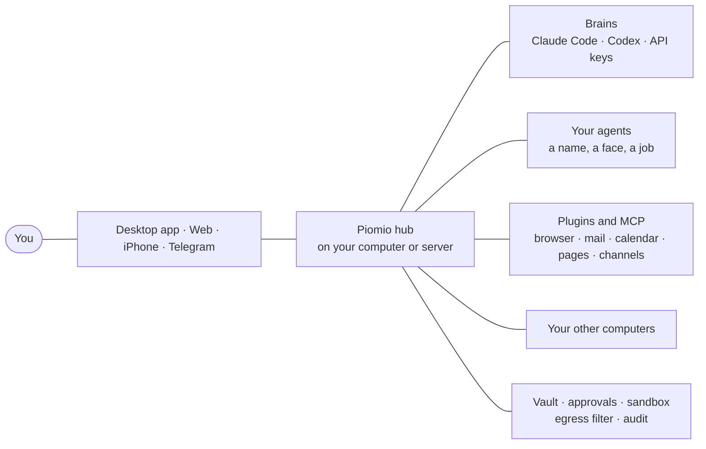

<p align="center">
  <a href="https://piomio.io"></a>
</p>

<h1 align="center">Piomio</h1>

<p align="center">
  <b>A team of AI agents that works for you.</b><br>
  They sort your mail, write letters you approve with one tap, work in a browser and learn by watching you.<br>
  On your own computers, with the subscriptions you already pay for. Open source.
</p>

<p align="center">
  <a href="https://piomio.io"><b>▶&nbsp;Live demo</b></a> &nbsp;·&nbsp;
  <a href="#install">Install</a> &nbsp;·&nbsp;
  <a href="#a-day-with-the-team">What it does</a> &nbsp;·&nbsp;
  <a href="#how-it-works">How it works</a> &nbsp;·&nbsp;
  <a href="README.ru.md">Русский</a>
</p>

<p align="center">
  <a href="https://github.com/legostin/piomio/releases/latest"></a>
  
  
  <a href="LICENSE"></a>
</p>

<p align="center">
  <a href="https://piomio.io"></a>
</p>
<p align="center"><sub>Not a mock-up: <a href="https://piomio.io">piomio.io</a> runs the real app in your browser on a demo hub, chapter by chapter.</sub></p>

## Meet the team

Piomio is a personal agent platform you run yourself. You get a small team of agents, each with a name, a face, a job and a memory, and you talk to them like to colleagues. They answer at once when they can, hand longer work to each other as tasks and come back when it is done. They think with the subscriptions you already have (Claude Code, Codex) or any API key, run on your Mac, PC or server, and never send, buy or delete anything without your yes. Think of it as an open-source alternative to Grok, Meta Muse and OpenAI Dots that lives with you.

## A day with the team

| | |
|---|---|
| ☀️&nbsp;**The morning brief comes by itself** | Meetings, the letters that matter, the weather, what not to forget. Then a nudge: leave for lunch at 12:30? |
| 📬&nbsp;**47 letters, sorted while you watch** | “Go through my mail.” Three that matter, two draft replies, the invoice turned into a task, the newsletters archived. |
| ✉️&nbsp;**Nothing leaves without your yes** | Letters, bookings, pushes and payments wait for one tap on a card. “Always allow” makes a rule for that one address. |
| 🛡️&nbsp;**The letter that asked too much** | A phishing mail tells the agent to forward your invoices. After outside content, a new recipient always asks you. Keys go into a vault the model never sees. |
| 🔌&nbsp;**A service in one sentence** | “Connect my Notion.” The card comes into the chat; you sign in once. Gmail, Google Calendar, Slack, GitHub, Linear, Notion and many more. |
| 👥&nbsp;**Three requests, one message** | The assistant splits them up: a teammate compares laptops, a reminder is set, the trains are found, and each answer comes back as a reply. |
| 💻&nbsp;**Your computers, your subscriptions** | An agent fixes a failing test on your MacBook through Claude Code; when that subscription hits its limit, it carries on with Codex. |
| 🎓&nbsp;**Show it once, and it’s done for you** | Order water in the agents’ browser while you talk. The agent keeps it as a skill, asks what it may press alone and up to what amount, and orders every Friday. |
| 🗺️&nbsp;**A page instead of a wall of text** | “Make a page for Saturday’s walk.” A real interactive page arrives in the chat: the route, places with prices, the weather, photos. |
| 📰&nbsp;**Your own news channel** | “Every morning, collect news about AI and electric cars.” An agent edits a channel: the gist, the numbers and a big picture. |

<p align="center">
  
</p>
<p align="center"><sub><b>Teach mode.</b> Show a task once in the agents’ browser, with your clicks, your voice and a highlight on what matters, and it becomes a skill the whole team can run.</sub></p>

<p align="center">
  
  &nbsp;&nbsp;
  
</p>
<p align="center"><sub><b>The team in your pocket.</b> The iPhone app (soon in TestFlight): every chat and card, approvals with Face ID.</sub></p>

## Install

**On your Mac or Windows PC.** About two minutes, nothing else to install.

1. Download Piomio from the [latest release](https://github.com/legostin/piomio/releases/latest): `piomio-<version>.dmg` for macOS 13.5 or later (Apple silicon and Intel), `piomio-setup-<version>-x64.exe` for Windows 10 and 11.
2. Open it, choose **A new Piomio on this computer** and pick a password.
3. In the chat, press **Sign in** on Claude Code or Codex (your subscription), or paste an API key.

That’s it. From here the assistant leads the setup in the chat, one step at a time: Telegram, a backup brain, other computers, getting to know you.

**On a server.** One Docker image:

```bash
git clone https://github.com/legostin/piomio.git && cd piomio
docker compose up -d
docker compose logs piomio | grep -A1 "Piomio:"
```

Open http://localhost:8080, enter the setup code from the logs and pick a password. On a remote server, connect from your computer first with `ssh -N -L 8080:localhost:8080 -L 8081:localhost:8081 you@server`, or open the hub on the server's address: see [On a server](#on-a-server).

**On your iPhone.** The app is coming to TestFlight soon. It pairs with your hub by a QR code, and approvals need Face ID.

**On more computers.** Each one joins as a machine with a one-time code: its files, its commands (if its owner allows) and its own Claude Code or Codex. See [Other computers](#other-computers).

## How to work with it

- **Just talk.** Write to an agent like to a person: several things at once if you like, even while it works. Quick things get answered right away; anything with steps becomes a task on the side, and the answer comes back as a reply to what you asked.
- **Tap instead of typing.** Agents ask with buttons under their messages. Cards in the chat connect services, take keys and show what an agent wants to do.
- **Say yes once.** Anything that leaves your computer (a letter, a booking, a push, a payment) waits for your tap. “Always allow” makes a narrow rule: one recipient, one site, up to an amount.
- **Let it run by itself.** Reminders, schedules, page watchers and news channels work in the background and decide on their own whether to stay quiet, add to the digest, notify you or ask.
- **Teach it.** Show a browser task once; the agent keeps it as a skill and does it when asked or on a schedule.
- **Wherever you are.** The desktop app for macOS and Windows, any browser, the iPhone app and Telegram: the same chats everywhere. One private link reaches your hub from anywhere, with no ports to open.

## How it works



- **The hub** is one Node.js process (the desktop app brings its own): chats, agents, memory, tasks, plugins, the vault and the security console.
- **Brains** are what agents think with. Claude Code and Codex run on your subscriptions; the Anthropic, OpenAI and OpenRouter APIs or any OpenAI-compatible server are fallbacks. When one hits its limit, the agent moves to the next and comes back once it resets.
- **Agents** are markdown files: a name, a face, a prompt, the brains and tools they may use. New ones are made in the chat.
- **Everything else is a plugin,** the interface included: the browser, memory, triggers, Telegram, integrations. See [docs/plugins.md](docs/plugins.md).

## Security, in short

- **Secrets stay in a vault.** Models only ever see `vault://` references, and secret values are stripped from everything that reaches a model, a channel or a log.
- **External actions need your yes,** and a separate console holds approvals, the vault and the audit log. After reading outside content (mail, the web), new recipients ask again.
- **Sandbox.** Brains and plugins run as separate users with their own folders, and all their traffic goes through an egress filter.
- **Audit.** Every tool call, decision and vault access lands in a hash-chained log you can verify.

## Reference

Everything in detail, one click away.


<details>
<summary><b>All features</b></summary>

- **Your subscriptions are the brains.** Claude Code (Claude subscription) and Codex (ChatGPT subscription) run as harnesses; the Anthropic, OpenAI and OpenRouter APIs, or any OpenAI-compatible server, act as fallbacks. When a subscription hits its limit, the agent moves on to the next brain and switches back once the limit resets.
- **Proactive.** Reminders, schedules, and watching pages and feeds. Background tasks decide for themselves whether something deserves your attention: stay silent, add it to the digest, send a notification, or ask you.
- **Agents as your entry point.** Tell an agent what you need, several things at once or more while it works: it answers quick things itself and hands everything that takes steps to tasks that run on the side, choosing the teammate and the computer (and asking you only when the choice is unclear). You see a line per task and get the results. A task can ask the agent who started it, and the agent can send it more details while it works: the input joins the work at its next step on every kind of brain (Claude Code, Codex, API).
- **Multiple agents and group chats.** Delegate work and run tasks in parallel. Put several agents into one chat: they see each other's replies, answer when you `@mention` them and hand the floor to each other. Agents are markdown files, each with its own list of brains and tools.
- **A lively chat.** Replies with formatting (headings, lists, tables, code) in the web UI and in Telegram alike. An agent can show a picture, a photo carousel or an OpenStreetMap map right in its message. Send it files, photos and screenshots the same way: the paperclip, a paste or a drop in the web UI, or simply in Telegram, where voice messages, albums and places work too. Voice messages are transcribed before the agent answers: with a Groq key (free tier), an OpenAI key, or your own Whisper server (**Settings → Voice messages**); the assistant offers to set it up when the first one arrives. Forms in the chat fold into a single line once saved, out of your way.
- **Memory.** Long-term memory about you, kept as markdown facts with git history and full-text search. Facts picked up in untrusted sessions wait for your review.
- **MCP and skills.** Connect any MCP server, skill or command. Claude Code and Codex plugins install as they are.
- **Built-in browser.** Chromium inside the container (outside Docker it installs itself on first use): websites, forms, screenshots, sign-in with passwords from the vault, and a live view where you can take over.
- **A network of machines.** Other computers join as nodes. The agent runs commands and works with files on them, and can use their subscriptions (Claude Code or Codex on your laptop).
- **Security.** A vault for passwords and personal data: the model only ever sees `vault://` references. External actions need your approval in a separate console. Plugins and CLI brains run in a sandbox under dedicated Unix users, and all their traffic goes through an egress filter. The audit log is protected by a hash chain.
- **Everything is a plugin, including the UI.** Panels, tabs, tool-result renderers, the composer, channels, brains, tools. See [docs/plugins.md](docs/plugins.md).
- **Channels.** The app for Windows and macOS, the iPhone app (see [Phone](#phone)), the web UI and Telegram.
- **Access from anywhere.** One permanent link to your hub for any browser and the phone app, through Piomio's own Tailscale node: nothing to install on the phone, no ports to open (see [Access from anywhere](#access-from-anywhere)).

</details>


<details>
<summary><b>Installing in detail: the desktop app and Docker</b></summary>

#### On your computer (Windows, macOS)

Get the app: `piomio-setup-<version>-x64.exe` for Windows 10 and 11, `piomio-<version>.dmg` for macOS 13.5 or later (Apple silicon and Intel). It brings everything it needs: no Node.js, Docker or WSL. To build it yourself, see [Desktop app](#desktop-app).

1. On Windows, run the installer: it installs for your user only and needs no administrator rights. On macOS, open the disk image, drag Piomio to Applications and open it from there.
2. The app asks how you will use this computer:
   - **A new Piomio on this computer**: the hub starts here and opens in the app's window. Choose a password and you are in (no setup code to copy). From then on the app signs its window in by itself.
   - **Connect to my Piomio**: your hub runs elsewhere and this computer becomes one of its machines. Paste the hub's address and the code from its **Machines** page, or click **Connect with the app** there. The window then shows that hub.
3. Closing the window keeps Piomio running in the background (Telegram, tasks, reminders); its icon in the menu bar or tray has Open, Start at login, Show log, Restart, Set up again…, Reset Piomio… and Quit. It starts by itself when you sign in to your computer.

Claude Code and Codex: if one is already installed on the computer and signed in, Piomio uses it, sign-in included — no need to sign in again. If not, pressing **Sign in** on its card installs it for Piomio (a one-time download of a few hundred MB), then the sign-in starts.

To start from scratch, choose **Reset Piomio…** in the icon's menu. The app lists what goes: chats, agents, memory, the vault with your secrets, plugins, settings, this computer's connection to a hub and the start-at-login entry. Once you confirm, it deletes all of it and either offers the first-run setup again or quits. Your Claude Code and Codex sign-ins stay: they belong to those tools, not to Piomio.

Your data stays in `%LOCALAPPDATA%\Piomio` (Windows) or `~/Library/Application Support/Piomio` (macOS); upgrading keeps it (an install from when Piomio was called Owlbot keeps its `Owlbot` folder). To upgrade on macOS, drag the new Piomio to Applications and replace the old one. To uninstall, use **Settings → Apps** on Windows (it asks before deleting your data) or move Piomio from Applications to the Trash on macOS (the data stays; to remove it too, first choose **Reset Piomio… → Delete and quit** in the icon's menu). The hub listens on `http://localhost:41780` (console `:41781`, egress proxy `:41789`), away from ports other tools tend to hold (8080, OpenClaw's 18789); another port goes into `desktop.json` in the data folder as `{"port": 19000}`. It is reachable from this computer only; for your phone, see [Phone](#phone).

The desktop version runs the hub, plugins and CLI brains as your own user: the Docker image's separate Unix users and its kernel-level network block are not there. For the strongest isolation, run Piomio in Docker.

The app is not signed yet. Windows SmartScreen may say "Windows protected your PC": choose **More info → Run anyway**. If macOS refuses to open it, choose **Open Anyway** in **System Settings → Privacy & Security** (on macOS 13 and 14, Control-clicking the app and choosing **Open** works too).

<a id="on-a-server"></a>
#### On a server (Docker)

```bash
git clone https://github.com/legostin/piomio.git && cd piomio
docker compose up -d
docker compose logs piomio | grep -A1 "Piomio:"
```

`docker compose` takes the ready image from GitHub (`ghcr.io/legostin/piomio`, amd64 and arm64): `latest` is the last release, `main` follows every change to main (`PIOMIO_IMAGE_TAG`). `docker compose up -d --build` builds it from the folder instead. To update: `git pull && docker compose pull && docker compose up -d`.

**Opening it.** The chat (`8080`) and the security console (`8081`) open on the server itself (`127.0.0.1`), so nothing faces the internet. From your computer:

- **Through SSH**, nothing to set up: run `ssh -N -L 8080:localhost:8080 -L 8081:localhost:8081 you@server` and keep it running. http://localhost:8080 in your browser is now the hub, passkeys included.
- **On the server's address**: put `PIOMIO_BIND=0.0.0.0` and `PIOMIO_PUBLIC_URL=http://<address>:8080` in `.env`, then `docker compose up -d`. Without `PIOMIO_PUBLIC_URL` the hub refuses every address but `localhost`. This is plain HTTP: on the open internet put HTTPS in front ([your own Tailscale or proxy](#your-own-proxy)). Note that Docker opens published ports past `ufw`.
- After the setup, [access from anywhere](#access-from-anywhere) gives the hub an HTTPS link of its own: one button in the chat.

1. Open http://localhost:8080 (or your address), enter the **setup code** from the logs and choose a password. Your browser's language becomes the hub language (see [Languages](#languages)).
2. Until a brain works, the chat shows a setup card: sign Claude Code or Codex in with your subscription (on a desktop install the hub can install a missing CLI first), or give an API key (see below). Whatever you write meanwhile is answered as soon as a brain is connected.
3. Then the assistant leads the rest of the setup in the chat, one step at a time and only when you agree: Telegram, a backup brain, other computers, and getting to know you. Say "not now" to skip a step, "let's continue the setup" to come back to it. When something needs a key or a token, the assistant shows a secure field in the chat: the value goes straight into the encrypted vault and the model only ever sees `vault://id`. You can also just paste a token into a message: the hub recognises known formats, takes it out of the message and stores it.

Settings go in `.env` next to `docker-compose.yml`: [.env.example](.env.example) lists each one with an example, [Environment variables](#environment-variables) has the defaults. Everything is stored in the `piomio-data` volume (`/data`): the database, the vault, workspaces, CLI logins and plugins.

</details>

<a id="languages"></a>
<details>
<summary><b>Languages</b></summary>

- The **hub language** is taken from the first user's browser during setup. You can pin it with `PIOMIO_LANG=en` or `PIOMIO_LANG=ru`, and change it later in **Settings**. It is used for notifications, Telegram, approval cards, and as the default language of the web UI.
- Each browser can switch the interface language on its own; this does not change the hub language.
- Agents reply in the language you write to them.

</details>


<details>
<summary><b>Connecting brains and API keys</b></summary>

**Claude Code (Claude Pro/Max subscription) and Codex (ChatGPT subscription)** sign in from the chat. Press **Sign in** next to the brain on the setup card, or ask the assistant ("connect Codex"): a card shows the sign-in page to open.

- **Codex:** enter the one-time code from the card on that page.
- **Claude Code:** sign in, copy the code the page shows and paste it into the card (not into the chat).

The card turns green once the brain is signed in. The login is kept on the server in `/data/home/agent`, so there is nothing to run in a terminal. The **Brains** page has the same buttons.

Claude Code can also use a long-lived token instead: run `claude setup-token` on any computer with Claude Code and paste the token into the chat. It is stored in the vault as **`claude_code_token`** and the Claude Code brain picks it up.

**API keys** (fallback brains, web search): ask the assistant ("connect Brave search") or paste the key into the chat. They are stored in the vault under these ids:

| id | Used for |
|---|---|
| `anthropic_api_key` | the `api:anthropic` brain |
| `openai_api_key` | the `api:openai` brain, Codex with an API key |
| `openrouter_api_key` | the `api:openrouter` brain |
| `custom_llm_api_key` | the `api:custom` brain (Ollama, LM Studio, vLLM or another OpenAI-compatible server), only if your server needs a key |
| `brave_api_key` or `tavily_api_key` | `web_search`; without a key, point the Web plugin settings at your own SearXNG (DuckDuckGo often answers with a bot check) |
| `telegram_bot_token` | the Telegram channel |

The address and model of an OpenAI-compatible server are set in the API brain plugin settings. A server on your local network also has to be listed in the `brainEgressAllow` setting (localhost is always reachable).

The **Brains** page shows the state of every brain: installed, signed in, rate-limited until a given time. The order in which brains are tried is set per agent.

</details>


<details>
<summary><b>Group chats</b></summary>

Invite several agents into one chat: in the sidebar, under **Groups**, choose **New group**, give it a name and pick two to eight agents. The first one you pick leads.

- A message without a mention goes to the lead.
- `@name` asks a particular agent: type `@` and the chat suggests the members.
- `@all` has everyone answer in turn, each seeing what was said before.
- An agent can hand the floor to another by mentioning it in its reply (at most three hand-offs per message of yours).

Change a group's name and members with the button next to its name. Group chats live in the app and the web UI; Telegram does not mirror them.

</details>


<details>
<summary><b>Telegram</b></summary>

1. Create a bot with [@BotFather](https://t.me/BotFather) and ask the assistant to connect Telegram: its card takes the token. The bot connects by itself.
2. In the same card, tap **Open the bot in Telegram** and press Start: that links your chat. The bot only answers the private chat it was linked from.

Telegram receives replies (with formatting: bold, lists, code, tables), notifications, the digest, and approval cards with buttons. Pictures in a reply arrive as photos or an album, a map as a location pin. Send the bot photos, albums, files and voice messages up to 20 MB (Telegram's limit for bots) or share a place: the agent gets them in its working folder. A forwarded message or a reply tells the agent where it came from or what it answers. Chat commands: `/help`, `/tasks`, `/stop`. The full details of an action are shown only in the console unless you turn on the `channelApprovalDetails` setting.

</details>


<details>
<summary><b>Integrations</b></summary>

**Settings → Integrations** lists the services your agents work with, as cards: access from anywhere, Google Calendar, Telegram, web search and the browser for now. Each card shows its status and the one button that moves it forward. You can also just ask the assistant ("connect my Google Calendar"): it shows the same card in the chat.

**Google Calendar.** Press **Connect with Google**, choose your account and allow access. Google sends the browser back to the hub. If the hub runs on a server or you sign in on a phone, the return page does not open: copy its address from the browser's address bar into the card. The sign-in is kept in the vault, so create or unlock the vault first (the card offers it). Then the agents see your events and free time, can book, move and delete events (each change asks for your approval), and the morning digest lists the day's plan, a later digest tomorrow's.

Piomio signs in with its own Google client. To use your own instead, create one in [Google Cloud](https://console.cloud.google.com/): a project with the Google Calendar API enabled, the OAuth consent screen (External, In production), and an OAuth client of type **Desktop app**. Then set `PIOMIO_GOOGLE_CLIENT_ID` and `PIOMIO_GOOGLE_CLIENT_SECRET`. Until Google verifies a client's calendar access, the sign-in shows an "unverified app" warning.

</details>

<a id="other-computers"></a>
<details>
<summary><b>Other computers</b></summary>

1. On the **Machines** page, connect a new machine to get a one-time code (valid for 10 minutes).
2. On the other computer (it only needs Node.js 24.5+), download the daemon from the hub and pair the machine:
   ```bash
   curl -fsSLo piomio-node.mjs https://your-hub-url/download/piomio-node.mjs
   node piomio-node.mjs pair https://your-hub-url <code> --name laptop
   node piomio-node.mjs run
   ```
3. The node appears in the list. Its local Claude Code and Codex become the brains `claude-code@<machine>` and `codex@<machine>`. What the agent may do on the machine (folders, commands, brains) is decided by the machine's owner in `~/.piomio-node/policy.json`; commands are off by default. Running the daemon as a service with systemd, launchd or Task Scheduler is covered in [packages/node/README.md](packages/node/README.md).

Under the team in the sidebar (and in the phone app's **Hub** tab) every machine shows whether it is online and, while agents work there, who works on what and what they are doing right now: running a command, reading or editing files, on the web, writing, or waiting for your approval. A row opens that chat or task.

</details>

<a id="phone"></a>
<details>
<summary><b>Phone</b></summary>

The Piomio iOS app (repository `piomio-ios`) is the hub in your pocket: your team of agents, the chats with every card, tasks, notifications, and approvals that need Face ID. The phone runs no brains; it connects to this hub.

1. In **Settings → Devices**, press **Connect a phone** and scan the QR code with the app, or open its link on the phone. You can also ask the assistant to "connect my phone", or run `piomio devices pair` on the server to get the QR in the terminal.
2. Confirm on the phone with Face ID.

The QR gives the phone every address it can use, and the phone takes whichever answers: the hub's own HTTPS port for phones on the home network (the hub's port + 2: 41782 in the desktop app, 8082 on a server; `PIOMIO_DEVICE_PORT`; only this port opens to the network, the web UI stays where it was), the computer's Tailscale address, and the link from [access from anywhere](#access-from-anywhere) (a phone paired before the link learns it on its next connection). `PIOMIO_DEVICES=0` closes the home-network port; phones then use the link alone. The phone pins the hub's own certificate from the QR, so no domain or CA is involved. Its token is revoked in one click in **Devices**; approving an action needs a signature by a key that stays in the phone's Secure Enclave, so a stolen token cannot approve anything. Rules, the vault's items and the audit stay in the security console. In Docker, publish the device port and list the addresses phones should use: `PIOMIO_DEVICE_URLS=https://192.168.1.10:8082`.

</details>

<a id="access-from-anywhere"></a>
<details>
<summary><b>Access from anywhere</b></summary>

**Settings → Integrations → Access from anywhere** gives the hub one permanent link, `https://piomio.<your-tailnet>.ts.net`. It opens the web UI in any browser and serves the phone app away from home; nothing needs installing on the phone or that other computer. Piomio runs its own [Tailscale](https://tailscale.com) node (`packages/tailnet`) and opens the link with Tailscale Funnel.

1. Press **Turn on**.
2. **Sign in to Tailscale**: a free account (Google, Apple, GitHub or Microsoft) is enough. The `piomio` node joins your tailnet.
3. **Allow Funnel**: Tailscale asks the tailnet's admin once.

Through the link come the web UI (sign in with your Piomio password: passkeys belong to the computer's own address), the phone app and other machines (`piomio-node pair <link> <code>`). Never through it: the first-run setup, the security console and plugin webhooks; brains on machines paired through the link reach the hub's tools there with their own session tokens. Wrong passwords are counted per address and, through the link, also together: 30 within an hour pause signing in from outside for an hour and notify you, while signing in on the computer keeps working. The node keeps its keys in `<data>/tailnet`; **Forget the node** signs it out of Tailscale and deletes them. Tailscale asks a node to sign in again after 180 days by default: the card warns two weeks ahead, and you can turn key expiry off for `piomio` in Tailscale's admin console. Piomio does not send Tailscale its node logs.

The desktop app and the Docker image include the node. When you run from source, build it with `npm run build:tailnet` (needs Go); without it the card says it is unavailable.

<a id="your-own-proxy"></a>
#### Your own Tailscale or proxy

Don't open the ports to the internet over plain HTTP. To reach the security console from elsewhere too, install [Tailscale](https://tailscale.com) on the host and let `tailscale serve` put HTTPS in front of both ports (HTTPS certificates must be enabled for your tailnet):

```bash
tailscale serve --bg --https=8080 http://127.0.0.1:8080
tailscale serve --bg --https=8081 http://127.0.0.1:8081
```

Then tell the hub its addresses:

```yaml
environment:
  PIOMIO_PUBLIC_URL: https://my-box.tailnet.ts.net:8080
  PIOMIO_CONSOLE_URL: https://my-box.tailnet.ts.net:8081
```

Passkeys (passwordless sign-in) need HTTPS or `localhost`; `tailscale serve` takes care of the certificate.

</details>


<details>
<summary><b>Security model</b></summary>

- **Two origins.** The chat and plugins live on `:8080`. Approvals, the vault, rules and the audit log live on `:8081`, with their own cookie, a strict CSP and `frame-ancestors 'none'`. Plugin code on the main page cannot read or click anything in the console.
- **Vault.** Secrets are encrypted with XChaCha20-Poly1305 under a data key, which in turn is wrapped by a key derived with Argon2id. Models only ever see `vault://id`. A plugin gets an item only if the item is declared in its permissions **and** the item's scope allows that plugin, domain or agent. Secret values are stripped from everything that goes to models, channels and logs. After a restart the vault is sealed, unless you ticked "unlock automatically" (the passphrase is then kept in `/data/vault.passphrase`, readable by the hub only) or pass a passphrase file through `PIOMIO_VAULT_PASSPHRASE_FILE` (a Docker secret).
- **Tool policy.** Every tool has an effect: `read`, `local-write` or `external`. External actions need approval by default. "Always allow" creates a narrow rule (one recipient, one domain). Once a session has read untrusted content (web, mail), new recipients need approval again. Background tasks of agents with an initiative below 2 can only read and notify.
- **Sandbox.** The hub runs as the `piomio` user, CLI brains as `agent`, other plugins and MCP servers as `plugin`. Their traffic goes through an egress proxy with allowlists. With `cap_add: [NET_ADMIN]` and `PIOMIO_EGRESS_ENFORCED=iptables`, the kernel blocks direct network access for `agent` and `plugin`.
- **Nodes.** Nodes authenticate with an Ed25519 key created during one-time pairing. Every action on a machine has to pass both the hub policy and the node's local policy.
- **Audit.** Every tool call, policy decision, vault access and sign-in is recorded in a hash-chained log. Check its integrity with `docker exec piomio piomio-entrypoint audit-verify` or in the console.

</details>


<details>
<summary><b>Container commands</b></summary>

```bash
docker exec piomio piomio-entrypoint reset-password 'new-password'
docker exec piomio piomio-entrypoint pairing-code laptop
docker exec piomio piomio-entrypoint backup /data/backups
docker exec piomio piomio-entrypoint audit-verify
```

- `reset-password` sets a new password (at least 8 characters) and signs out every session.
- `pairing-code [name]` issues a one-time code for connecting a machine.
- `backup [dir]` copies the databases, agents, skills, commands and plugins with their data; the vault stays encrypted.
- `audit-verify` checks the audit log's hash chain and exits with code 2 if it is broken.

</details>


<a id="environment-variables"></a>
<details>
<summary><b>Environment variables</b></summary>

On a server they go in `.env` next to `docker-compose.yml` ([.env.example](.env.example) has them with examples). The first two are read by `docker-compose.yml` itself.

| Variable | Default | |
|---|---|---|
| `PIOMIO_IMAGE_TAG` | `latest` | the image `docker-compose.yml` runs: `latest` (the last release), `main` (every change to main) or a version |
| `PIOMIO_BIND` | `127.0.0.1` | where `docker-compose.yml` opens ports 8080 and 8081 on the server: `0.0.0.0` opens them on every address (set `PIOMIO_PUBLIC_URL` too) |
| `PIOMIO_PUBLIC_URL` | `http://localhost:8080` | address of the chat UI, used for links and the Origin check |
| `PIOMIO_CONSOLE_URL` | same host, port 8081 | address of the security console |
| `PIOMIO_ALLOWED_HOSTS` | — | extra host names, comma-separated |
| `PIOMIO_LANG` | — | pins the hub language: `en` or `ru` |
| `PIOMIO_VAULT_PASSPHRASE_FILE` | — | unlocks the vault automatically |
| `PIOMIO_EGRESS_ENFORCED` | `proxy` | `iptables` blocks direct network access outright (needs `NET_ADMIN`) |
| `PIOMIO_SETUP_TOKEN` | random | sets the setup code in advance |
| `PIOMIO_TRUST_PROXY` | — | `1` trusts `X-Forwarded-*` from a reverse proxy |
| `PIOMIO_HOST` | `127.0.0.1` (`0.0.0.0` in the image) | listen address |
| `PIOMIO_PORT`, `PIOMIO_CONSOLE_PORT`, `PIOMIO_EGRESS_PORT` | `8080`, `8081`, `8089` | ports of the chat UI, the console and the egress proxy |
| `PIOMIO_DEVICE_PORT`, `PIOMIO_DEVICE_HOST` | port + 2 (`8082`), `0.0.0.0` | the phones' HTTPS port and where it listens |
| `PIOMIO_DEVICES` | — | `0` closes the phones' port on the network: phones then reach the hub only through the link |
| `PIOMIO_DEVICE_URLS` | detected | addresses for the pairing QR, comma-separated, ahead of the detected ones |
| `PIOMIO_DATA_DIR` | `.data/` (`/data` in the image) | data directory |
| `PIOMIO_INSTALL_CLIS` | — (`1` in the desktop installers) | `1` lets **Sign in** install a missing Claude Code or Codex into `<data>/tools` |
| `PIOMIO_GOOGLE_CLIENT_ID`, `PIOMIO_GOOGLE_CLIENT_SECRET` | Piomio's client | your own Google OAuth client (type Desktop app) for Google integrations |
| `PIOMIO_TAILNET_BIN` | `packages/tailnet/bin/<platform>-<arch>/piomio-tailnet` | the hub's Tailscale node for access from anywhere |
| `PIOMIO_TAILNET_HOSTNAME` | `piomio` | the node's name in your tailnet: the link's first label |
| `PIOMIO_REPLICA_NAME` | the host name | what this machine is called among the hub's replicas |
| `PIOMIO_NODE_URLS` | the machine's address | where machines reach this hub, comma-separated |
| `PIOMIO_ROUTER_URL` | `https://routing.openstreetmap.de` | the OSRM server for routes on maps |
| `TZ` | system time zone (`UTC` in the image) | default time zone for reminders, quiet hours and the digest |

Most behaviour is configured in **Settings** in the web UI: language, time zone, quiet hours, digest times, `channelApprovalDetails` (full action details in Telegram) and `brainEgressAllow` (extra hosts brains may reach). One hub setting has no field on that page yet: `egressPrivateAllow`, the local-network hosts plugins and brains may reach (for example `searxng` or `nas.local`); set it through `PATCH /api/settings`.

</details>

<a id="desktop-app"></a>
<details>
<summary><b>Development and building the desktop app</b></summary>

```bash
npm install
npm run build        # web UI, console, UI plugins, node daemon bundle
npm run build:tailnet  # the hub's Tailscale node (Go; --all for every platform)
npm run dev          # hub on :8080 / :8081, egress proxy on :8089 (data in .data/)
npm test             # unit and integration tests
npm run typecheck
```

You need Node.js 24.5+ (TypeScript runs without a build step). Outside Docker the browser plugin downloads Playwright's Chromium by itself the first time it starts without one (a one-time download into Playwright's cache, or `PLAYWRIGHT_BROWSERS_PATH`); browser calls made meanwhile wait for it. Set `PLAYWRIGHT_SKIP_BROWSER_DOWNLOAD=1` to turn that off and install it yourself with `npx playwright install chromium`. The project layout and conventions are described in [CLAUDE.md](CLAUDE.md), the design in [docs/superpowers/specs](docs/superpowers/specs/2026-10-26-piomio-design.md) (in Russian). Core messages live in `packages/core/src/locales/{en,ru}.ts`, plugin messages in `.piomio-plugin/locales/{en,ru}.json`; `npm test` checks that every translation matches English.

#### Desktop app

```bash
npm run package:desktop   # on Windows: dist/desktop/piomio-setup-<version>-x64.exe
                          # on macOS:   dist/desktop/piomio-<version>.dmg and .pkg
```

The app lives in `packages/desktop` (Tauri 2: Rust in `src-tauri`, its setup screens in `ui`). The build compiles the UIs, stages the hub with its production `node_modules` and the official Node 24 build, checked against the release's SHA-256 (`packaging/desktop/stage.mjs`; `NODE_VERSION` picks another release), and bundles it into the app. It needs Rust from [rustup](https://rustup.rs); on macOS also the Intel target for the universal build (`rustup target add x86_64-apple-darwin`) and Xcode's command line tools. App and installer texts live in `packaging/desktop/locales/{en,ru}.json`.

Silent installs: `piomio-setup-<version>-x64.exe /S` (add `/NOSTART` to leave it stopped) on Windows; `sudo installer -pkg piomio-<version>.pkg -target /` on macOS (over SSH or MDM), and `sudo /Applications/Piomio.app/Contents/Resources/uninstall.sh <uid> <home> [--delete-data]` removes it again. `Piomio --mode hub --background` makes the first-run choice without a window, `Piomio --quit` stops the running app. `.github/workflows/desktop.yml` builds both on clean runners and checks that they install, start the hub, quit and uninstall.

To try a build next to an installed Piomio, add `-- --test`: it makes **Piomio Test** (`piomio-test-<version>.dmg`, `piomio-test-setup-<version>-x64.exe`) with its own data, machine pairing, start-at-login entry and ports right after the app's (41790, console 41791, egress proxy 41799). Its window titles, tray menu and setup screens say it is a test build.

To run the app from source without touching an installed Piomio: stage once (`node packaging/desktop/stage.mjs --skip-build`), then `PIOMIO_APP_ROOT=$PWD/dist/desktop/stage-darwin/app PIOMIO_DATA_DIR=/tmp/owl-data npm run tauri -w @piomio/desktop -- dev` with `{"port":18080}` in `/tmp/owl-data/desktop.json`. With `PIOMIO_DATA_DIR` set the app writes no start-at-login entries.

</details>

## License

[Apache-2.0](LICENSE)
