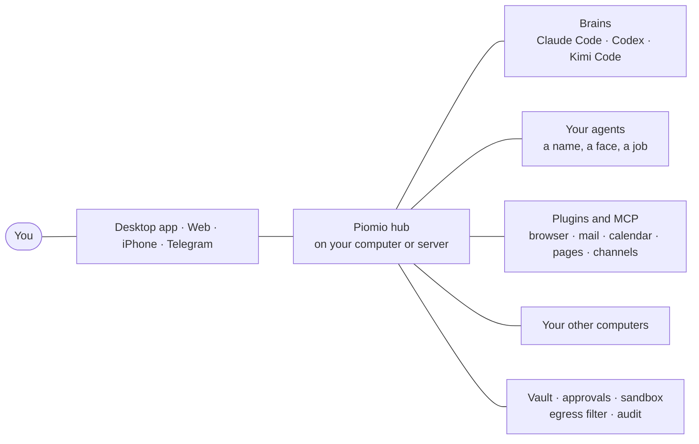

<p align="center">
  <a href="https://piomio.io"></a>
</p>

<h1 align="center">Piomio</h1>

<p align="center">
  <b>A small team of AI agents that lives on your own computers.</b><br>
  They go through your email, draft replies you send with one tap, and pick up a chore after you show it to them once.<br>
  Free and open source, running on the plans you already pay for, through the official Claude Code, Codex and Kimi Code CLIs.
</p>

<p align="center">
  <a href="https://piomio.io"><b>▶&nbsp;Live demo</b></a> &nbsp;·&nbsp;
  <a href="#install">Install</a> &nbsp;·&nbsp;
  <a href="#a-day-with-the-team">What it does</a> &nbsp;·&nbsp;
  <a href="#how-it-works">How it works</a> &nbsp;·&nbsp;
  <a href="https://piomio.io/en/docs/">Docs</a> &nbsp;·&nbsp;
  <a href="README.ru.md">Русский</a> &nbsp;·&nbsp;
  <a href="README.zh-CN.md">简体中文</a>
</p>

<p align="center">
  <a href="https://github.com/legostin/piomio/releases/latest"></a>
  
  
  <a href="LICENSE"></a>
</p>

<p align="center">
  <a href="https://piomio.io"></a>
</p>
<p align="center"><sub>That’s the real app. <a href="https://piomio.io">piomio.io</a> runs it in your browser on a demo hub, one chapter at a time.</sub></p>

## Meet the team

Piomio is a personal agent platform you run yourself. You get a small team of agents, each with a name, a face, a job and a memory, and you talk to them the way you would to colleagues. Quick things they answer on the spot. Longer work gets passed around as tasks, and they come back to you when it’s done.

They think through the official Claude Code, Codex and Kimi Code CLIs, signed in with the plan you already have, and they run on your Mac, PC or server. Before they send or buy anything, they ask you. Think of it as an open-source alternative to Grok, Meta Muse and OpenAI Dots, except it lives on your own machine.

## A day with the team

| | |
|---|---|
| ☀️&nbsp;**The morning brief arrives on its own** | Today’s meetings, the emails worth reading, the weather and the dentist you keep forgetting. Then it offers to remind you to leave for lunch at 12:30. |
| 📬&nbsp;**47 emails, sorted while you watch** | “Go through my mail.” Three turn out to matter. One reply gets drafted, the invoice becomes a task and the newsletters go to the archive. (Gmail connects through Composio.) |
| ✉️&nbsp;**It asks before anything goes out** | Emails, bookings, pushes and payments wait for one tap on a card. “Always allow” adds a rule for that one address and nothing else. |
| 🛡️&nbsp;**The email that asked too much** | A phishing email tells the agent to forward your invoices. Because the agent has just read outside mail, a new recipient has to get your yes. Keys go into a vault the model never sees. |
| 🔌&nbsp;**A service in one sentence** | “Connect my Notion.” A card shows up in the chat and you sign in once. Notion, Linear and anything with an MCP server connect directly; Gmail, Google Calendar, Slack, GitHub and many more come through Composio, an outside service whose cloud sees that data. |
| 👥&nbsp;**Three requests, one message** | The assistant splits them up. A teammate compares laptops while the reminder gets set and the trains are found, and each answer comes back as a reply to your message. |
| 💻&nbsp;**Out of Claude Code, on to Codex** | An agent fixes a failing test on your MacBook through Claude Code. When your Claude plan hits its limit, it carries on with Codex. |
| 🎓&nbsp;**Show it a chore once** | Order water in the agents’ browser and talk as you go. The agent saves it as a skill, asks what it may press without you and up to what amount, then orders every Friday. |
| 🗺️&nbsp;**A page instead of a wall of text** | “Make a page for Saturday’s walk.” You get an interactive page in the chat with the route, places with prices, the weather and photos. |
| 📰&nbsp;**Your own news channel** | “Every morning, collect news about AI and electric cars.” An agent edits the channel and posts the gist, the numbers and a picture. |

<p align="center">
  
</p>
<p align="center"><sub><b>Teach mode.</b> Do a task once in the agents’ browser. Click, talk, highlight the bits that matter, and it turns into a skill anyone on the team can run.</sub></p>

<p align="center">
  
  &nbsp;&nbsp;
  
</p>
<p align="center"><sub><b>The iPhone app</b> is in beta on <a href="https://testflight.apple.com/join/g4hCfeXA">TestFlight</a>, with every chat and card, and Face ID for approvals.</sub></p>

## Install

**On your Mac or Windows PC.** About two minutes, nothing else to install.

1. Download Piomio from the [latest release](https://github.com/legostin/piomio/releases/latest): `piomio-<version>.dmg` for macOS 13.5 or later (Apple silicon and Intel), `piomio-setup-<version>-x64.exe` for Windows 10 and 11.
2. Open it, choose **A new Piomio on this computer** and pick a password.
3. In the chat, press **Sign in** on Claude Code, Codex or Kimi Code (your subscription).

From there the assistant walks you through the rest in the chat, one thing at a time: Telegram, a backup brain, other computers, and getting to know you.

**On a server.** One command on Linux (x64 or arm64), as root:

```bash
curl -fsSL https://piomio.io/install.sh | sh
```

It makes a user `piomio` for the hub and its agents and prints the setup code, then Tailscale's sign-in page and, once you have signed in with a free account, the hub's permanent link, which opens on any phone or computer (an `ssh -L` tunnel works too). Sign in to Claude Code, Codex or Kimi Code as that user, and the agents use it as it is: nothing to copy. The server can also be a computer of the hub on your Mac instead: the card that connects a computer shows its command. Step by step: [the server guide](https://piomio.io/en/server/), and [On a Linux server](https://piomio.io/en/docs/server/) in the docs.

**With your AI.** Already use Claude Code, Codex or Kimi Code? Paste this into it on the computer or server where Piomio should run:

```text
Install Piomio on this computer and set it up for me. Follow https://piomio.io/setup.md step by step. You will need the internet: if a download fails, ask me for permission instead of stopping. Ask me whenever a decision is mine, and never ask me for passwords or keys. At the end, tell me how to open the chat.
```

It works out what the machine is, installs Piomio and asks you only what is yours to decide ([what it will do](https://piomio.io/setup.md)). On a Mac or PC, Piomio then works with that same Claude Code, Codex or Kimi Code: no second sign-in. Codex says it can't ask before downloading? Choose "Ask for approval" in its `/permissions`.

**On your iPhone.** The app is in beta on [TestFlight](https://testflight.apple.com/join/g4hCfeXA) (iOS 26 or later). It pairs with your hub through a QR code, and approvals need Face ID.

**On more computers.** Each one joins with a one-time code. The agents can then use its files, its own Claude Code or Codex (signed in there with your own account), and its commands if you allow them. See [Machines and other computers](https://piomio.io/en/docs/machines/).

## How to work with it

- **Just talk.** Write to an agent the way you’d write to a person. Several things at once is fine, even while it’s busy. Quick things get answered right away. Anything with steps becomes a task on the side, and the answer comes back as a reply to what you asked.
- **Tap instead of typing.** Agents often ask with buttons under their messages. Cards in the chat connect services, take keys and show what an agent is about to do.
- **Say yes once.** Anything an agent sends out (an email, a booking, a push, a payment) waits for your tap. “Always allow” makes a narrow rule for one recipient or one site, up to an amount.
- **Let it run by itself.** Reminders, schedules, page watchers and news channels work in the background. Each one decides whether to stay quiet, add to the digest, notify you or ask.
- **Teach it.** Show it a browser task once. It keeps that as a skill and does it when asked, or on a schedule.
- **Wherever you are.** You get the same chats in the desktop app for macOS and Windows, in any browser, in Telegram and in the iPhone app. One private link reaches your hub from anywhere, and there are no ports to open.

## How it works



- **The hub** is one Node.js process (the desktop app brings its own Node). It holds the chats, agents, memory, tasks, plugins, the vault and the security console.
- **Brains** are what agents think with: the official Claude Code, Codex and Kimi Code CLIs, signed in with your own plan, and plain API keys on a hub that allows them. When one hits its limit, the agent carries on with the next.
- **Agents** are markdown files with a name, a face, a prompt, and the brains and tools they may use. You make new ones in the chat.
- **Everything else is a plugin,** the interface included: the browser, memory, Telegram, integrations. See [docs/plugins.md](docs/plugins.md).

## Security, in short

- **Secrets stay in a vault.** Models only ever see `vault://` references, and secret values are stripped from anything headed to a model, a channel or a log.
- **Actions that reach outside need your yes.** A separate console holds the approvals, the vault and the audit log. After an agent has read outside content (mail, the web), a new recipient needs your yes again.
- **Sandbox.** Brains and plugins reach the web through an egress filter with allowlists. On a Mac, the CLI brains' own commands stay inside the agent's folder (a macOS sandbox) and ask you for the rest; on a server, everything runs as a user without sudo.
- **Audit.** Every tool call, decision and vault access goes into a hash-chained log you can verify.

## Docs

Everything in detail, for the version you run, is on the site: **[piomio.io/en/docs](https://piomio.io/en/docs/)**. The pages are Markdown in [docs/guide](docs/guide), next to the code they describe, and change with it.

<a id="reference"></a><a id="on-a-server"></a><a id="server-hub"></a><a id="server-computer"></a><a id="server-address"></a><a id="languages"></a><a id="other-computers"></a><a id="phone"></a><a id="access-from-anywhere"></a><a id="your-own-proxy"></a><a id="environment-variables"></a>

| | |
|---|---|
| **Getting started** | [Overview](https://piomio.io/en/docs/) · [Install on a Mac or PC](https://piomio.io/en/docs/install/) · [On a Linux server](https://piomio.io/en/docs/server/) · [First run](https://piomio.io/en/docs/first-run/) |
| **Working with the team** | [The chat](https://piomio.io/en/docs/chat/) · [Agents and the team](https://piomio.io/en/docs/agents/) · [Tasks, schedules, Inbox](https://piomio.io/en/docs/tasks/) · [Channels](https://piomio.io/en/docs/channels/) · [Pages](https://piomio.io/en/docs/pages/) · [Browser and teach mode](https://piomio.io/en/docs/browser/) |
| **Brains and computers** | [Brains and sign-in](https://piomio.io/en/docs/brains/) · [Machines and other computers](https://piomio.io/en/docs/machines/) · [The iPhone app](https://piomio.io/en/docs/phone/) · [Telegram](https://piomio.io/en/docs/telegram/) · [Access from anywhere](https://piomio.io/en/docs/anywhere/) · [Updates](https://piomio.io/en/docs/updates/) |
| **Safety** | [Approvals and auto mode](https://piomio.io/en/docs/approvals/) · [Security model](https://piomio.io/en/docs/security/) |
| **Reference** | [Plugins and integrations](https://piomio.io/en/docs/plugins/) · [Settings](https://piomio.io/en/docs/settings/) · [Troubleshooting](https://piomio.io/en/docs/troubleshooting/) |

<a id="desktop-app"></a>
<details>
<summary><b>Development and building the desktop app</b></summary>

```bash
npm install
npm run build        # web UI, console, UI plugins, node daemon bundle
npm run build:tailnet  # the hub's Tailscale node (Go; --all for every platform)
npm run dev          # hub on :8080 / :8081, egress proxy on :8089 (data in .data/)
npm test             # unit and integration tests
npm run typecheck
```

You need Node.js 24.5+ (TypeScript runs without a build step). Without Google Chrome the browser plugin downloads Playwright's Chromium by itself the first time it starts without one (a one-time download into Playwright's cache, or `PLAYWRIGHT_BROWSERS_PATH`); browser calls made meanwhile wait for it. Set `PLAYWRIGHT_SKIP_BROWSER_DOWNLOAD=1` to turn that off and install it yourself with `npx playwright install chromium`. The project layout and conventions are described in [CLAUDE.md](CLAUDE.md), the design in [docs/superpowers/specs](docs/superpowers/specs/2026-10-26-piomio-design.md) (in Russian). Core messages live in `packages/core/src/locales/{en,ru}.ts`, plugin messages in `.piomio-plugin/locales/{en,ru}.json`; `npm test` checks that every translation matches English.

#### Desktop app

```bash
npm run package:desktop   # on Windows: dist/desktop/piomio-setup-<version>-x64.exe
                          # on macOS:   dist/desktop/piomio-<version>.dmg and .pkg
```

The app lives in `packages/desktop` (Tauri 2: Rust in `src-tauri`, its setup screens in `ui`). The build compiles the UIs, stages the hub with its production `node_modules` and the official Node 24 build, checked against the release's SHA-256 (`packaging/desktop/stage.mjs`; `NODE_VERSION` picks another release), and bundles it into the app. It needs Rust from [rustup](https://rustup.rs); on macOS also the Intel target for the universal build (`rustup target add x86_64-apple-darwin`) and Xcode's command line tools. App and installer texts live in `packaging/desktop/locales/{en,ru}.json`.

Silent installs: `piomio-setup-<version>-x64.exe /S` (add `/NOSTART` to leave it stopped) on Windows; `sudo installer -pkg piomio-<version>.pkg -target /` on macOS (over SSH or MDM), and `sudo /Applications/Piomio.app/Contents/Resources/uninstall.sh <uid> <home> [--delete-data]` removes it again. `Piomio --mode hub --background` makes the first-run choice without a window, `Piomio --quit` stops the running app. `.github/workflows/desktop.yml` builds both on clean runners and checks that they install, start the hub, quit and uninstall.

To try a build next to an installed Piomio, add `-- --test`: it makes **Piomio Test** (`piomio-test-<version>.dmg`, `piomio-test-setup-<version>-x64.exe`) with its own data, machine pairing, start-at-login entry and ports right after the app's (41790, console 41791, egress proxy 41799). Its window titles, tray menu and setup screens say it is a test build.

To run the app from source without touching an installed Piomio: stage once (`node packaging/desktop/stage.mjs --skip-build`), then `PIOMIO_APP_ROOT=$PWD/dist/desktop/stage-darwin/app PIOMIO_DATA_DIR=/tmp/owl-data npm run tauri -w @piomio/desktop -- dev` with `{"port":18080}` in `/tmp/owl-data/desktop.json`. With `PIOMIO_DATA_DIR` set the app writes no start-at-login entries.

</details>

## License

[Apache-2.0](LICENSE)

Piomio is an independent open-source project, not affiliated with or endorsed by Anthropic, OpenAI or Moonshot AI. Claude and Claude Code are trademarks of Anthropic; ChatGPT and Codex are trademarks of OpenAI; Kimi is a trademark of Moonshot AI. Piomio runs their official CLIs, which you sign in to with your own account, and each use stays under that provider's terms.
