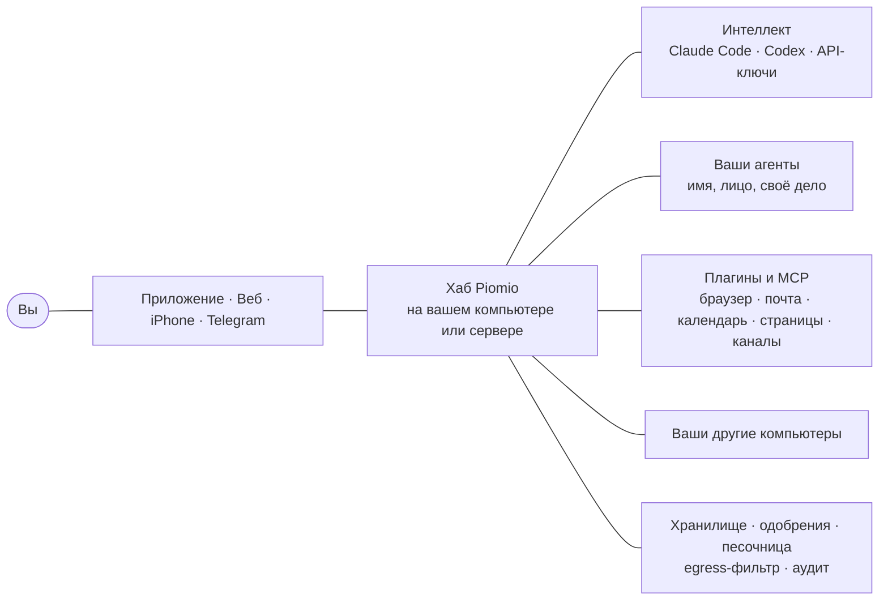

<p align="center">
  <a href="https://piomio.io/ru/"></a>
</p>

<h1 align="center">Piomio</h1>

<p align="center">
  <b>Команда ИИ-агентов, которая работает на вас.</b><br>
  Разбирает почту, пишет письма, которые вы одобряете одним нажатием, работает в браузере и учится, глядя на вас.<br>
  На ваших компьютерах, на подписках, за которые вы уже платите. Открытый код.
</p>

<p align="center">
  <a href="https://piomio.io/ru/"><b>▶&nbsp;Живое демо</b></a> &nbsp;·&nbsp;
  <a href="#установка">Установка</a> &nbsp;·&nbsp;
  <a href="#день-с-командой">Что умеет</a> &nbsp;·&nbsp;
  <a href="#как-это-устроено">Как устроено</a> &nbsp;·&nbsp;
  <a href="README.md">English</a>
</p>

<p align="center">
  <a href="https://github.com/legostin/piomio/releases/latest"></a>
  
  
  <a href="LICENSE"></a>
</p>

<p align="center">
  <a href="https://piomio.io/ru/"></a>
</p>
<p align="center"><sub>Это не макет: на <a href="https://piomio.io/ru/">piomio.io</a> настоящее приложение работает прямо в вашем браузере на демо-хабе, глава за главой.</sub></p>

## Знакомьтесь: команда

Piomio — платформа личных агентов, которую вы запускаете у себя. У вас появляется небольшая команда: у каждого агента имя, лицо, своё дело и память, и разговариваете вы с ними как с коллегами. Быстрое они делают сразу, долгую работу передают друг другу задачами и возвращаются с результатом. Думают на подписках, которые у вас уже есть (Claude Code, Codex), или на любом API-ключе, работают на вашем Mac, ПК или сервере и ничего не отправляют, не покупают и не удаляют без вашего «да». Это open-source альтернатива Grok, Meta Muse и OpenAI Dots, которая живёт у вас.

## День с командой

| | |
|---|---|
| ☀️&nbsp;**Утренняя сводка приходит сама** | Встречи, важные письма, погода, что не забыть. И подсказка: выйти на обед в 12:30? |
| 📬&nbsp;**47 писем разобраны на ваших глазах** | «Разбери почту». Три важных, два черновика ответа, счёт превратился в задачу, рассылки ушли в архив. |
| ✉️&nbsp;**Ничего не уходит без вашего «да»** | Письма, бронирования, пуши и оплаты ждут одного нажатия на карточке. «Разрешать всегда» создаёт правило только для этого адреса. |
| 🛡️&nbsp;**Письмо, которое просило слишком много** | Фишинговое письмо велит агенту переслать ваши счета. После чужого письма новый адресат всегда спрашивает вас. Ключи лежат в хранилище, которого модель не видит. |
| 🔌&nbsp;**Сервис одной фразой** | «Подключи Notion». Карточка приходит в чат, входите один раз. Gmail, Google Календарь, Slack, GitHub, Linear, Notion и многое другое. |
| 👥&nbsp;**Три просьбы в одном сообщении** | Ассистент раскладывает их: коллега сравнивает ноутбуки, напоминание стоит, поезда найдены, и каждый результат приходит ответом на вашу просьбу. |
| 💻&nbsp;**Ваши компьютеры, ваши подписки** | Агент чинит упавший тест на вашем MacBook через Claude Code, а когда эта подписка упирается в лимит, продолжает на Codex. |
| 🎓&nbsp;**Покажите один раз — дальше сам** | Закажите воду в браузере агентов и расскажите по ходу. Агент сохранит это как навык, спросит, что можно нажимать без вас и до какой суммы, и будет заказывать каждую пятницу. |
| 🗺️&nbsp;**Страница вместо стены текста** | «Сделай страницу прогулки на субботу». В чат приходит настоящая интерактивная страница: маршрут, места с ценами, погода, фото. |
| 📰&nbsp;**Свой канал новостей** | «Каждое утро собирай новости про ИИ и электромобили». Агент ведёт канал: суть, цифры и большая картинка. |

<p align="center">
  
</p>
<p align="center"><sub><b>Режим обучения.</b> Покажите задачу один раз в браузере агентов — кликами, голосом и выделением важного — и она станет навыком, который выполнит любой агент команды.</sub></p>

<p align="center">
  
  &nbsp;&nbsp;
  
</p>
<p align="center"><sub><b>Команда в кармане.</b> Приложение для iPhone (скоро в TestFlight): все чаты и карточки, одобрения по Face ID.</sub></p>

## Установка

**На Mac или Windows.** Около двух минут, больше ничего ставить не нужно.

1. Скачайте Piomio из [последнего релиза](https://github.com/legostin/piomio/releases/latest): `piomio-<version>.dmg` для macOS 13.5 и новее (Apple silicon и Intel), `piomio-setup-<version>-x64.exe` для Windows 10 и 11.
2. Откройте его, выберите **Новый Piomio на этом компьютере** и придумайте пароль.
3. В чате нажмите **Войти** у Claude Code или Codex (ваша подписка) или вставьте API-ключ.

Готово. Дальше настройку в чате ведёт ассистент, по одному шагу: Telegram, запасной интеллект, другие компьютеры, знакомство с вами.

**На сервере.** Один Docker-образ:

```bash
git clone https://github.com/legostin/piomio.git && cd piomio
docker compose up -d
docker compose logs piomio | grep -A1 "Piomio:"
```

Откройте http://localhost:8080, введите код установки из логов и придумайте пароль. Если сервер удалённый, сначала подключитесь к нему со своего компьютера: `ssh -N -L 8080:localhost:8080 -L 8081:localhost:8081 you@server`, или откройте хаб на адресе сервера: см. [На сервере](#на-сервере).

**На iPhone.** Приложение скоро появится в TestFlight. Оно подключается к хабу по QR-коду, а одобрения подтверждаются Face ID.

**На других компьютерах.** Каждый подключается как машина по одноразовому коду: его файлы, его команды (если владелец разрешит) и его собственные Claude Code или Codex. См. [Другие компьютеры](#другие-компьютеры).

## Как с ним работать

- **Просто пишите.** Пишите агенту как человеку: хоть несколько дел сразу, хоть пока он работает. Быстрое он делает сразу, всё, где есть шаги, уходит задачей в сторону, а результат приходит ответом на ваше сообщение.
- **Нажимайте, а не набирайте.** Агенты спрашивают кнопками под сообщениями. Карточки в чате подключают сервисы, принимают ключи и показывают, что агент хочет сделать.
- **Одно «да».** Всё, что уходит с вашего компьютера (письмо, бронь, пуш, оплата), ждёт вашего нажатия. «Разрешать всегда» создаёт узкое правило: один адресат, один сайт, сумма до предела.
- **Пусть работает само.** Напоминания, расписания, слежка за страницами и каналы новостей работают в фоне и сами решают: промолчать, добавить в сводку, уведомить или спросить.
- **Научите.** Покажите задачу в браузере один раз — агент сохранит её как навык и выполнит по просьбе или по расписанию.
- **Везде, где вы.** Приложение для macOS и Windows, любой браузер, приложение для iPhone и Telegram — везде одни и те же чаты. Одна личная ссылка открывает хаб откуда угодно, порты открывать не нужно.

## Как это устроено



- **Хаб** — один процесс Node.js (в приложении для компьютера он уже встроен): чаты, агенты, память, задачи, плагины, хранилище и пульт безопасности.
- **Интеллект** — то, чем думают агенты. Claude Code и Codex работают на ваших подписках, а API Anthropic, OpenAI и OpenRouter или любой OpenAI-совместимый сервер служат запасными. Когда один упирается в лимит, агент переходит к следующему и возвращается, когда лимит сбросится.
- **Агенты** — markdown-файлы: имя, лицо, промпт, разрешённые интеллекты и инструменты. Новых создают прямо в чате.
- **Всё остальное — плагины,** включая интерфейс: браузер, память, триггеры, Telegram, интеграции. Подробности — в [docs/plugins.ru.md](docs/plugins.ru.md).

## Безопасность коротко

- **Секреты — в хранилище.** Модели видят только ссылки `vault://`, а сами значения вычищаются из всего, что попадает в модель, канал или лог.
- **Внешние действия — только с вашего «да»,** а одобрения, хранилище и журнал аудита живут в отдельном пульте. После чужого контента (почта, веб) новые адресаты снова спрашивают.
- **Песочница.** Интеллект и плагины работают от отдельных пользователей со своими папками, весь их трафик идёт через egress-фильтр.
- **Аудит.** Каждый вызов инструмента, решение и доступ к хранилищу попадают в журнал с цепочкой хэшей, который можно проверить.

## Справка

Всё подробно — в одно нажатие.


<details>
<summary><b>Все возможности</b></summary>

- **Ваши подписки как «интеллект».** Claude Code (подписка Claude) и Codex (подписка ChatGPT) работают как харнессы, а API Anthropic, OpenAI, OpenRouter и любой OpenAI-совместимый сервер — как запасной вариант. Когда упираетесь в лимит подписки, агент сам переключается на следующий интеллект и возвращается, когда лимит сбросится.
- **Проактивность.** Напоминания, расписания и мониторинг страниц и лент. Фоновые задачи сами решают, стоит ли вас беспокоить: молча, в дайджест, уведомление или вопрос.
- **Агент — входная точка.** Говорите агенту, что нужно, хоть несколько дел сразу или ещё по ходу работы: быстрое он делает сам, а всё, где есть шаги, отдаёт задачам, которые идут в стороне. Он сам выбирает, кто из команды и на каком компьютере будет работать, и спрашивает вас, только если выбор неочевиден. Вы видите по строке на задачу и получаете результаты. Задача может спросить агента, который её поставил, а агент может дослать ей подробности на ходу: они попадают в работу на ближайшем шаге у любого интеллекта (Claude Code, Codex, API).
- **Несколько агентов и групповые чаты.** Задачи можно делегировать и выполнять параллельно. Нескольких агентов можно собрать в один чат: они видят реплики друг друга, отвечают по упоминанию `@имя` и передают друг другу слово. Агенты описываются markdown-файлами, у каждого свой список интеллектов и инструментов.
- **Живой чат.** Ответы с разметкой (заголовки, списки, таблицы, код) — и в веб-интерфейсе, и в Telegram. Агент может показать картинку, карусель фотографий или карту OpenStreetMap прямо в сообщении. Ему можно так же отправлять файлы, фото и скриншоты: скрепкой, вставкой или перетаскиванием в веб-интерфейсе или просто в Telegram, где работают ещё голосовые, альбомы и места на карте. Голосовые расшифровываются до ответа агента: с ключом Groq (есть бесплатный тариф), OpenAI или через свой сервер Whisper (**Настройки → Голосовые сообщения**). С первым голосовым ассистент сам предложит это настроить. Формы в чате после сохранения сворачиваются в одну строку и не мешают дальше.
- **Память.** Долговременная память о вас: markdown-факты с историей в git и полнотекстовым поиском. Факты из недоверенных сессий ждут вашей проверки.
- **MCP и скиллы.** Подключаются любые MCP-серверы, скиллы и команды. Плагины Claude Code и Codex ставятся как есть.
- **Встроенный браузер.** Chromium внутри контейнера (вне Docker он ставится сам при первом использовании): сайты, формы, скриншоты, вход по паролям из vault и живой экран, на котором можно перехватить управление.
- **Сеть машин.** Другие компьютеры подключаются как узлы. Агент запускает на них команды, работает с файлами и использует их подписки (Claude Code или Codex на ноутбуке).
- **Безопасность.** Vault для паролей и личных данных: модель видит только ссылки `vault://`. Внешние действия требуют подтверждения в отдельном пульте. Плагины и CLI-интеллекты работают в песочнице под отдельными unix-пользователями, весь их трафик идёт через egress-фильтр. Журнал аудита защищён цепочкой хэшей.
- **Всё — плагины, включая интерфейс.** Панели, вкладки, рендер результатов, композер, каналы, интеллекты, инструменты. Подробности — в [docs/plugins.ru.md](docs/plugins.ru.md).
- **Каналы.** Приложение для Windows и macOS, приложение для iPhone (см. [Телефон](#телефон)), веб-интерфейс и Telegram.
- **Доступ из любого места.** Одна постоянная ссылка на хаб для любого браузера и приложения на телефоне через собственный узел Tailscale в Piomio: на телефон ничего ставить не нужно, порты открывать тоже (см. [Доступ из любого места](#доступ-из-любого-места)).

</details>


<details>
<summary><b>Установка подробно: приложение и Docker</b></summary>

#### На вашем компьютере (Windows, macOS)

Возьмите приложение: `piomio-setup-<version>-x64.exe` для Windows 10 и 11, `piomio-<version>.dmg` для macOS 13.5 и новее (Apple silicon и Intel). В нём есть всё нужное: Node.js, Docker и WSL не понадобятся. Как собрать его самому, описано в разделе [Приложение для компьютера](#приложение-для-компьютера).

1. В Windows запустите установщик: он ставит Piomio только для вашего пользователя и не просит прав администратора. В macOS откройте образ диска, перетащите Piomio в «Программы» и откройте его оттуда.
2. Приложение спросит, как вы будете пользоваться этим компьютером:
   - **Новый Piomio на этом компьютере**: хаб запустится здесь и откроется в окне приложения. Придумайте пароль, и всё готово (код установки копировать не нужно). Дальше приложение входит в своё окно само.
   - **Подключить к моему Piomio**: ваш хаб работает в другом месте, а этот компьютер станет одной из его машин. Вставьте адрес хаба и код со страницы **Машины** или нажмите там **Подключить через приложение**. Окно покажет тот хаб.
3. Если закрыть окно, Piomio продолжит работать в фоне (Telegram, задачи, напоминания); у его значка в строке меню или трее есть пункты «Открыть», «Запускать при входе в систему», «Показать журнал», «Перезапустить», «Настроить заново…», «Сбросить Piomio…» и «Выйти». При входе в систему он запускается сам.

Claude Code и Codex: если один из них уже установлен на компьютере и вы в него вошли, Piomio возьмёт его вместе со входом — входить второй раз не нужно. Если нет, кнопка **Войти** на его карточке установит его для Piomio (разовая загрузка на несколько сотен МБ), а потом начнётся вход.

Чтобы начать с чистого листа, выберите в меню значка **Сбросить Piomio…**. Приложение покажет, что удалится: чаты, агенты, память, хранилище с секретами, плагины, настройки, подключение компьютера к хабу и автозапуск. После подтверждения оно удалит всё это и либо снова предложит первую настройку, либо закроется. Входы в Claude Code и Codex останутся: они принадлежат этим программам, а не Piomio.

Данные лежат в `%LOCALAPPDATA%\Piomio` (Windows) или `~/Library/Application Support/Piomio` (macOS); обновление их сохраняет (установка тех времён, когда Piomio назывался Owlbot, остаётся в папке `Owlbot`). Чтобы обновить Piomio в macOS, перетащите новую версию в «Программы» и замените старую. Удалить Piomio можно в **Параметры → Приложения** в Windows (он спросит, удалять ли ваши данные) или перетащив Piomio из «Программ» в Корзину в macOS (данные останутся; чтобы удалить и их, сначала выберите в меню значка **Сбросить Piomio… → Удалить и выйти**). Хаб слушает `http://localhost:41780` (пульт — `:41781`, egress-прокси — `:41789`), в стороне от портов, которые часто заняты другими программами (8080, 18789 у OpenClaw); другой порт задаётся в `desktop.json` в папке данных как `{"port": 19000}`. Он доступен только с этого компьютера; как подключить телефон, описано в разделе [Телефон](#телефон).

На компьютере хаб, плагины и CLI-интеллекты работают от вашего пользователя: отдельных Unix-пользователей и блокировки сети на уровне ядра, как в Docker-образе, здесь нет. Для самой строгой изоляции запускайте Piomio в Docker.

Приложение пока не подписано. Windows SmartScreen может написать «Система Windows защитила ваш компьютер»: нажмите **Подробнее → Выполнить в любом случае**. Если macOS не открывает приложение, нажмите **Все равно открыть** в **Системные настройки → Конфиденциальность и безопасность** (в macOS 13 и 14 можно и щёлкнуть приложение с Control и выбрать **Открыть**).

<a id="на-сервере"></a>
#### На сервере (Docker)

```bash
git clone https://github.com/legostin/piomio.git && cd piomio
docker compose up -d
docker compose logs piomio | grep -A1 "Piomio:"
```

`docker compose` берёт готовый образ с GitHub (`ghcr.io/legostin/piomio`, amd64 и arm64): `latest` — последний релиз, `main` — каждое изменение в main (`PIOMIO_IMAGE_TAG`). `docker compose up -d --build` вместо этого соберёт образ из папки. Обновить: `git pull && docker compose pull && docker compose up -d`.

**Как открыть.** Чат (`8080`) и консоль безопасности (`8081`) открываются только на самом сервере (`127.0.0.1`), в интернет ничего не смотрит. Со своего компьютера:

- **Через SSH**, ничего настраивать не нужно: запустите `ssh -N -L 8080:localhost:8080 -L 8081:localhost:8081 you@server` и не закрывайте. Теперь http://localhost:8080 в браузере — это хаб, и ключи доступа (passkeys) тоже работают.
- **На адресе сервера**: впишите в `.env` `PIOMIO_BIND=0.0.0.0` и `PIOMIO_PUBLIC_URL=http://<адрес>:8080`, затем `docker compose up -d`. Без `PIOMIO_PUBLIC_URL` хаб отвечает только на `localhost`. Это обычный HTTP: в открытом интернете поставьте перед ним HTTPS ([свой Tailscale или прокси](#свой-прокси)). Учтите, что Docker открывает опубликованные порты в обход `ufw`.
- После настройки [доступ из любого места](#доступ-из-любого-места) даёт хабу собственную HTTPS-ссылку: одна кнопка в чате.

1. Откройте http://localhost:8080 (или свой адрес), введите **код установки** из логов и придумайте пароль. Язык вашего браузера станет языком хаба (см. [Языки](#языки)).
2. Пока не работает ни один интеллект, чат показывает карточку настройки: войдите в Claude Code или Codex по своей подписке (в установке на компьютер хаб сначала сам поставит недостающий CLI) или дайте API-ключ (см. ниже). На всё, что вы напишете в это время, ассистент ответит, как только интеллект подключится.
3. Дальше настройку в чате ведёт ассистент, по одному шагу и только с вашего согласия: Telegram, запасной интеллект, другие компьютеры и знакомство с вами. «Не сейчас» пропускает шаг, «продолжим настройку» возвращает к нему. Когда для чего-то нужен ключ или токен, ассистент покажет в чате защищённое поле: значение сразу уходит в зашифрованное хранилище, а модель видит только `vault://id`. Можно и просто вставить токен в сообщение: хаб узнаёт известные форматы, вырезает токен из сообщения и сохраняет его.

Настройки пишутся в `.env` рядом с `docker-compose.yml`: в [.env.example](.env.example) каждая с примером, значения по умолчанию — в [Переменных окружения](#переменные-окружения). Данные лежат в томе `piomio-data` (`/data`): база, vault, рабочие папки, логины CLI, плагины.

</details>

<a id="языки"></a>
<details>
<summary><b>Языки</b></summary>

- **Язык хаба** берётся из браузера первого пользователя при установке. Его можно закрепить переменной `PIOMIO_LANG=en` или `PIOMIO_LANG=ru`, а позже поменять в «Настройках». На нём приходят уведомления, сообщения в Telegram и карточки подтверждения, и он же — язык интерфейса по умолчанию.
- В каждом браузере язык интерфейса можно переключить отдельно; язык хаба от этого не меняется.
- Агенты отвечают на том языке, на котором вы им пишете.

</details>


<details>
<summary><b>Подключение интеллекта и API-ключи</b></summary>

**Claude Code (подписка Claude Pro/Max) и Codex (подписка ChatGPT)** входят прямо из чата. Нажмите **«Войти»** рядом с интеллектом в карточке настройки или попросите ассистента («подключи Codex»): карточка покажет страницу входа, которую нужно открыть.

- **Codex:** введите на этой странице одноразовый код из карточки.
- **Claude Code:** войдите, скопируйте код, который покажет страница, и вставьте его в карточку (не в чат).

Когда интеллект авторизуется, карточка станет зелёной. Логин хранится на сервере в `/data/home/agent`, так что в терминале ничего запускать не нужно. На странице «Интеллект» есть те же кнопки.

Вместо этого Claude Code может работать по долгоживущему токену: выполните `claude setup-token` на любом компьютере с Claude Code и вставьте токен в чат. Он сохранится в хранилище как **`claude_code_token`**, и интеллект Claude Code его подхватит.

**API-ключи** (запасные интеллекты, веб-поиск): попросите ассистента («подключи поиск Brave») или вставьте ключ в чат. В хранилище они лежат под такими id:

| id | Для чего |
|---|---|
| `anthropic_api_key` | интеллект `api:anthropic` |
| `openai_api_key` | интеллект `api:openai`, Codex по ключу |
| `openrouter_api_key` | интеллект `api:openrouter` |
| `custom_llm_api_key` | интеллект `api:custom` (Ollama, LM Studio, vLLM или другой OpenAI-совместимый сервер), только если серверу нужен ключ |
| `brave_api_key` или `tavily_api_key` | `web_search`; без ключа укажите свой SearXNG в настройках плагина «Веб» (DuckDuckGo часто отвечает проверкой на бота) |
| `telegram_bot_token` | канал Telegram |

Адрес и модель OpenAI-совместимого сервера задаются в настройках плагина API-интеллекта. Сервер в локальной сети нужно ещё добавить в настройку `brainEgressAllow` (localhost доступен всегда).

Состояние интеллектов (установлен, вошёл, лимит до …) видно на странице «Интеллект». Порядок интеллектов задаётся у каждого агента.

</details>


<details>
<summary><b>Групповые чаты</b></summary>

Нескольких агентов можно позвать в один чат: в боковой панели в разделе **Группы** нажмите **Новая группа**, дайте ей название и выберите от двух до восьми агентов. Первый выбранный — ведущий.

- Сообщение без упоминания получает ведущий.
- `@имя` зовёт конкретного агента: наберите `@`, и чат подскажет участников.
- `@все` — ответят все по очереди, и каждый видит, что уже сказали до него.
- Агент может сам передать слово другому, упомянув его в ответе (не больше трёх передач на одно ваше сообщение).

Название и состав группы меняются по кнопке рядом с её названием. Групповые чаты живут в приложении и веб-интерфейсе, в Telegram они не дублируются.

</details>


<details>
<summary><b>Telegram</b></summary>

1. Создайте бота у [@BotFather](https://t.me/BotFather) и попросите ассистента подключить Telegram: токен вводится в его карточку. Бот подключится сам.
2. В той же карточке нажмите **«Открыть бота в Telegram»** и затем «Старт»: так чат привяжется. Бот отвечает только тому личному чату, из которого его привязали.

В Telegram приходят ответы (с разметкой: жирный текст, списки, код, таблицы), уведомления, дайджест и карточки подтверждения с кнопками. Картинки из ответа приходят фотографиями или альбомом, карта — точкой на карте. Боту можно отправлять фото, альбомы, файлы и голосовые до 20 МБ (ограничение Telegram для ботов) или место на карте: агент получит их в своей рабочей папке. По пересланному сообщению или ответу на сообщение агент понимает, откуда оно и на что вы отвечаете. Команды в чате: `/help`, `/tasks`, `/stop`. Подробности действия видны только в пульте, если не включить настройку `channelApprovalDetails`.

</details>


<details>
<summary><b>Интеграции</b></summary>

**Настройки → Интеграции** — это сервисы, с которыми работают ваши агенты, в виде карточек: пока доступ из любого места, Google Календарь, Telegram, поиск в интернете и браузер. Карточка показывает состояние и одну кнопку, которая продвигает дело. Можно и просто попросить ассистента («подключи мой Google Календарь»): он покажет ту же карточку в чате.

**Google Календарь.** Нажмите **Войти через Google**, выберите аккаунт и разрешите доступ. Google вернёт браузер в хаб. Если хаб работает на сервере или вы входите с телефона, страница возврата не откроется: скопируйте её адрес из строки браузера в карточку. Вход хранится в хранилище, поэтому сначала создайте или откройте его (карточка это предложит). После этого агенты видят ваши события и свободное время, могут создавать, переносить и удалять события (каждое изменение — с вашего подтверждения), а утренняя сводка показывает план дня, вечерняя — на завтра.

Piomio входит в Google через свой клиент. Чтобы использовать свой, создайте его в [Google Cloud](https://console.cloud.google.com/): проект с включённым Google Calendar API, экран согласия OAuth (External, In production) и OAuth-клиент типа **Desktop app**. Затем задайте `PIOMIO_GOOGLE_CLIENT_ID` и `PIOMIO_GOOGLE_CLIENT_SECRET`. Пока Google не проверил доступ клиента к календарю, при входе будет предупреждение «непроверенное приложение».

</details>

<a id="другие-компьютеры"></a>
<details>
<summary><b>Другие компьютеры</b></summary>

1. На странице «Машины» нажмите «Подключить машину» и получите одноразовый код (действует 10 минут).
2. На другом компьютере (нужен только Node.js 24.5+) скачайте демон с хаба и привяжите машину; `<code>` — полученный код:
   ```bash
   curl -fsSLo piomio-node.mjs https://your-hub-url/download/piomio-node.mjs
   node piomio-node.mjs pair https://your-hub-url <code> --name laptop
   node piomio-node.mjs run
   ```
3. Узел появится в списке. Его локальные Claude Code и Codex станут интеллектами `claude-code@<машина>` и `codex@<машина>`. Что агенту можно делать на машине (папки, команды, интеллекты), решает владелец машины в `~/.piomio-node/policy.json`. По умолчанию команды выключены. Автозапуск через systemd, launchd и Планировщик заданий описан в [packages/node/README.ru.md](packages/node/README.ru.md).

Под командой в боковой панели (и на вкладке **Хаб** в приложении для телефона) у каждой машины видно, в сети ли она, а пока там работают агенты — кто над чем работает и что делает прямо сейчас: запускает команду, читает или правит файлы, ищет в интернете, пишет ответ или ждёт вашего решения. Строка открывает этот чат или задачу.

</details>

<a id="телефон"></a>
<details>
<summary><b>Телефон</b></summary>

iOS-приложение Piomio (репозиторий `piomio-ios`) — хаб в кармане: команда агентов, чаты со всеми карточками, задачи, уведомления и подтверждения по Face ID. На телефоне нет интеллектов: он подключается к этому хабу.

1. В **Настройки → Устройства** нажмите **«Подключить телефон»** и отсканируйте QR приложением или откройте ссылку на телефоне. Можно и попросить ассистента «подключи мой телефон» или выполнить на сервере `piomio devices pair` — QR появится в терминале.
2. Подтвердите на телефоне через Face ID.

QR даёт телефону все адреса, по которым тот может достучаться, и телефон берёт тот, что ответит: отдельный HTTPS-порт хаба для телефонов в домашней сети (порт хаба + 2: 41782 в десктоп-приложении, 8082 на сервере; `PIOMIO_DEVICE_PORT`; в сеть открывается только он, веб остаётся где был), адрес компьютера в Tailscale и ссылку из [доступа из любого места](#доступ-из-любого-места) (телефон, привязанный раньше, узнаёт её при следующем подключении). `PIOMIO_DEVICES=0` закрывает порт в домашней сети, и тогда телефоны ходят только по ссылке. Телефон пинит собственный сертификат хаба из QR, поэтому домен и CA не нужны. Токен телефона отзывается в один клик в «Устройствах»; чтобы разрешить действие, нужна подпись ключом, который не покидает Secure Enclave телефона, так что украденный токен ничего не разрешит. Правила, записи vault и аудит остаются на пульте. В Docker опубликуйте порт для телефонов и укажите адреса, по которым их искать: `PIOMIO_DEVICE_URLS=https://192.168.1.10:8082`.

</details>

<a id="доступ-из-любого-места"></a>
<details>
<summary><b>Доступ из любого места</b></summary>

**Настройки → Интеграции → Доступ из любого места** даёт хабу одну постоянную ссылку `https://piomio.<ваша-сеть>.ts.net`. Она открывает веб-интерфейс в любом браузере и обслуживает приложение на телефоне вне дома; на телефон и другой компьютер ничего ставить не нужно. Piomio запускает собственный узел [Tailscale](https://tailscale.com) (`packages/tailnet`) и открывает ссылку через Tailscale Funnel.

1. Нажмите **«Включить»**.
2. **Войдите в Tailscale**: хватит бесплатного аккаунта (Google, Apple, GitHub или Microsoft). Узел `piomio` появится в вашей сети.
3. **Разрешите Funnel**: Tailscale один раз спросит администратора сети.

По ссылке доступны веб-интерфейс (вход по паролю Piomio: passkey привязаны к адресу самого компьютера), приложение на телефоне и другие машины (`piomio-node pair <ссылка> <код>`). Никогда не доступны: первая настройка, консоль безопасности и вебхуки плагинов; интеллекты на машинах, привязанных по ссылке, обращаются к инструментам хаба через неё со своими токенами сессий. Неверные пароли считаются по адресам, а для ссылки ещё и вместе: 30 за час приостанавливают вход извне на час и присылают вам уведомление, вход на самом компьютере продолжает работать. Ключи узла лежат в `<data>/tailnet`; **«Забыть узел»** выходит из Tailscale и удаляет их. По умолчанию Tailscale просит узел войти заново через 180 дней: карточка предупредит за две недели, а в консоли администратора Tailscale можно отключить срок ключа для `piomio`. Логи узла Piomio в Tailscale не отправляет.

Узел входит в приложение для компьютера и в Docker-образ. При запуске из исходников соберите его командой `npm run build:tailnet` (нужен Go); без него карточка скажет, что доступ недоступен.

<a id="свой-прокси"></a>
#### Свой Tailscale или прокси

Не открывайте порты в интернет по голому HTTP. Чтобы извне была доступна и консоль безопасности, поставьте [Tailscale](https://tailscale.com) на хост и откройте оба порта через `tailscale serve` с HTTPS (в tailnet должны быть включены HTTPS-сертификаты):

```bash
tailscale serve --bg --https=8080 http://127.0.0.1:8080
tailscale serve --bg --https=8081 http://127.0.0.1:8081
```

Затем укажите адреса хаба:

```yaml
environment:
  PIOMIO_PUBLIC_URL: https://my-box.tailnet.ts.net:8080
  PIOMIO_CONSOLE_URL: https://my-box.tailnet.ts.net:8081
```

Для passkeys (вход без пароля) нужен HTTPS или `localhost`. `tailscale serve` получает сертификат автоматически.

</details>


<details>
<summary><b>Модель безопасности</b></summary>

- **Два origin.** Чат и плагины работают на `:8080`. Подтверждения, vault, правила и аудит — на `:8081`, с отдельной cookie, строгим CSP и `frame-ancestors 'none'`. Код плагинов в основной странице не может прочитать или нажать то, что в пульте.
- **Vault.** Секреты шифруются: XChaCha20-Poly1305 с ключом данных, обёрнутым ключом из Argon2id. Модели видят только `vault://id`. Плагин получает запись, только если она объявлена в его правах **и** её область разрешает этот плагин, домен или агента. Значения секретов вырезаются из всего, что уходит модели, в каналы и в логи. После перезапуска vault запечатан, если при создании не отмечено «открывать автоматически» (тогда парольная фраза хранится в `/data/vault.passphrase`, её может прочитать только хаб) и не передан файл с паролем через `PIOMIO_VAULT_PASSPHRASE_FILE` (docker secret).
- **Политика инструментов.** У каждого инструмента есть эффект: `read`, `local-write` или `external`. Внешние действия по умолчанию требуют подтверждения. «Всегда разрешать» создаёт узкое правило (получатель, домен). Если сессия читала недоверенный контент (веб, почта), новые адресаты снова требуют подтверждения. Фоновые задачи агентов с инициативой ниже 2 могут только читать и уведомлять.
- **Песочница.** Хаб работает от пользователя `piomio`, CLI-интеллекты — от `agent`, остальные плагины и MCP-серверы — от `plugin`. Трафик идёт через egress-прокси с белыми списками. С `cap_add: [NET_ADMIN]` и `PIOMIO_EGRESS_ENFORCED=iptables` прямой выход в сеть для `agent` и `plugin` закрыт на уровне ядра.
- **Узлы.** Узлы аутентифицируются ключом Ed25519, полученным при одноразовом спаривании. Каждое действие на машине проходит политику хаба и локальную политику узла.
- **Аудит.** Все вызовы инструментов, решения политики, доступ к vault и входы записываются в журнал с цепочкой хэшей. Проверить целостность можно командой `docker exec piomio piomio-entrypoint audit-verify` или в пульте.

</details>


<details>
<summary><b>Команды контейнера</b></summary>

```bash
docker exec piomio piomio-entrypoint reset-password 'new-password'
docker exec piomio piomio-entrypoint pairing-code laptop
docker exec piomio piomio-entrypoint backup /data/backups
docker exec piomio piomio-entrypoint audit-verify
```

- `reset-password` задаёт новый пароль (не короче 8 символов) и завершает все сессии.
- `pairing-code [имя]` выдаёт одноразовый код для подключения машины.
- `backup [папка]` копирует базы, агентов, скиллы, команды и плагины с их данными; vault остаётся зашифрованным.
- `audit-verify` проверяет цепочку хэшей журнала аудита и завершается с кодом 2, если она нарушена.

</details>


<a id="переменные-окружения"></a>
<details>
<summary><b>Переменные окружения</b></summary>

На сервере они пишутся в `.env` рядом с `docker-compose.yml` (в [.env.example](.env.example) они с примерами). Первые две читает сам `docker-compose.yml`.

| Переменная | По умолчанию | |
|---|---|---|
| `PIOMIO_IMAGE_TAG` | `latest` | какой образ запускает `docker-compose.yml`: `latest` (последний релиз), `main` (каждое изменение в main) или версия |
| `PIOMIO_BIND` | `127.0.0.1` | где `docker-compose.yml` открывает порты 8080 и 8081 на сервере: `0.0.0.0` — на всех адресах (тогда задайте и `PIOMIO_PUBLIC_URL`) |
| `PIOMIO_PUBLIC_URL` | `http://localhost:8080` | адрес чата, нужен для ссылок и проверки Origin |
| `PIOMIO_CONSOLE_URL` | тот же хост, порт 8081 | адрес пульта |
| `PIOMIO_ALLOWED_HOSTS` | — | дополнительные имена хоста через запятую |
| `PIOMIO_LANG` | — | закрепить язык хаба: `en` или `ru` |
| `PIOMIO_VAULT_PASSPHRASE_FILE` | — | автоматическая разблокировка vault |
| `PIOMIO_EGRESS_ENFORCED` | `proxy` | `iptables` — жёсткий запрет прямого выхода (нужен `NET_ADMIN`) |
| `PIOMIO_SETUP_TOKEN` | случайный | задать код установки заранее |
| `PIOMIO_TRUST_PROXY` | — | `1` — доверять `X-Forwarded-*` от обратного прокси |
| `PIOMIO_HOST` | `127.0.0.1` (в образе `0.0.0.0`) | адрес, на котором слушает хаб |
| `PIOMIO_PORT`, `PIOMIO_CONSOLE_PORT`, `PIOMIO_EGRESS_PORT` | `8080`, `8081`, `8089` | порты чата, пульта и egress-прокси |
| `PIOMIO_DEVICE_PORT`, `PIOMIO_DEVICE_HOST` | порт + 2 (`8082`), `0.0.0.0` | HTTPS-порт для телефонов и адрес, на котором он слушает |
| `PIOMIO_DEVICES` | — | `0` закрывает порт для телефонов в сети: тогда телефоны ходят к хабу только по ссылке |
| `PIOMIO_DEVICE_URLS` | определяются сами | адреса для QR привязки через запятую, раньше найденных автоматически |
| `PIOMIO_DATA_DIR` | `.data/` (в образе `/data`) | папка с данными |
| `PIOMIO_INSTALL_CLIS` | — (`1` в установщиках для компьютера) | `1` разрешает кнопке **Войти** установить недостающий Claude Code или Codex в `<data>/tools` |
| `PIOMIO_GOOGLE_CLIENT_ID`, `PIOMIO_GOOGLE_CLIENT_SECRET` | клиент Piomio | свой OAuth-клиент Google (тип Desktop app) для интеграций Google |
| `PIOMIO_TAILNET_BIN` | `packages/tailnet/bin/<платформа>-<архитектура>/piomio-tailnet` | узел Tailscale хаба для доступа из любого места |
| `PIOMIO_TAILNET_HOSTNAME` | `piomio` | имя узла в вашей сети: первая часть ссылки |
| `PIOMIO_REPLICA_NAME` | имя хоста | как эта машина называется среди реплик хаба |
| `PIOMIO_NODE_URLS` | адрес машины | где машины находят этот хаб, через запятую |
| `PIOMIO_ROUTER_URL` | `https://routing.openstreetmap.de` | сервер OSRM для маршрутов на картах |
| `TZ` | часовой пояс системы (в образе `UTC`) | часовой пояс по умолчанию для напоминаний, тихих часов и дайджеста |

Большая часть поведения настраивается в «Настройках» веб-интерфейса: язык, часовой пояс, тихие часы, время дайджеста, `channelApprovalDetails` (подробности действия в Telegram) и `brainEgressAllow` (дополнительные хосты для интеллектов). Для одной настройки хаба на этой странице пока нет поля: `egressPrivateAllow` — хосты локальной сети, к которым можно плагинам и интеллектам (например, `searxng` или `nas.local`); её меняют через `PATCH /api/settings`.

</details>

<a id="приложение-для-компьютера"></a>
<details>
<summary><b>Разработка и сборка приложения</b></summary>

```bash
npm install
npm run build        # web UI, console, UI plugins, node daemon bundle
npm run build:tailnet  # the hub's Tailscale node (Go; --all for every platform)
npm run dev          # hub on :8080 / :8081, egress proxy on :8089 (data in .data/)
npm test             # unit and integration tests
npm run typecheck
```

Нужен Node.js 24.5+ (TypeScript запускается без сборки). Вне Docker плагин браузера сам скачивает Chromium для Playwright, если при старте его нет (один раз, в кэш Playwright или в `PLAYWRIGHT_BROWSERS_PATH`); браузерные вызовы на это время ждут загрузки. Чтобы отключить это и поставить браузер самому (`npx playwright install chromium`), задайте `PLAYWRIGHT_SKIP_BROWSER_DOWNLOAD=1`. Устройство проекта и соглашения описаны в [CLAUDE.md](CLAUDE.md), дизайн — в [docs/superpowers/specs](docs/superpowers/specs/2026-10-26-piomio-design.md). Сообщения ядра лежат в `packages/core/src/locales/{en,ru}.ts`, сообщения плагинов — в `.piomio-plugin/locales/{en,ru}.json`; `npm test` проверяет, что каждый перевод совпадает с английским.

#### Приложение для компьютера

```bash
npm run package:desktop   # в Windows: dist/desktop/piomio-setup-<version>-x64.exe
                          # в macOS:   dist/desktop/piomio-<version>.dmg и .pkg
```

Приложение лежит в `packages/desktop` (Tauri 2: Rust в `src-tauri`, его экраны настройки в `ui`). Сборка собирает интерфейсы, складывает хаб с production-зависимостями и официальной сборкой Node 24, сверенной с SHA-256 из релиза (`packaging/desktop/stage.mjs`; другой релиз задаёт `NODE_VERSION`), и упаковывает его в приложение. Нужен Rust из [rustup](https://rustup.rs); в macOS ещё цель Intel для универсальной сборки (`rustup target add x86_64-apple-darwin`) и инструменты командной строки Xcode. Тексты приложения и установщиков лежат в `packaging/desktop/locales/{en,ru}.json`.

Тихая установка: `piomio-setup-<version>-x64.exe /S` (с `/NOSTART` приложение не запустится) в Windows; `sudo installer -pkg piomio-<version>.pkg -target /` в macOS (по SSH или через MDM), а `sudo /Applications/Piomio.app/Contents/Resources/uninstall.sh <uid> <home> [--delete-data]` удаляет его. `Piomio --mode hub --background` делает выбор первого запуска без окна, `Piomio --quit` останавливает работающее приложение. `.github/workflows/desktop.yml` собирает обе версии на чистых машинах и проверяет, что они ставятся, запускают хаб, выходят и удаляются.

Чтобы попробовать сборку рядом с установленным Piomio, добавьте `-- --test`: получится **Piomio Test** (`piomio-test-<version>.dmg`, `piomio-test-setup-<version>-x64.exe`) со своими данными, подключением машины, автозапуском и портами сразу за основными (41790, пульт — 41791, egress-прокси — 41799). В заголовке окна, меню в трее и на экранах настройки видно, что это тестовая сборка.

Чтобы запустить приложение из исходников, не трогая установленный Piomio: один раз подготовьте сборку (`node packaging/desktop/stage.mjs --skip-build`), затем `PIOMIO_APP_ROOT=$PWD/dist/desktop/stage-darwin/app PIOMIO_DATA_DIR=/tmp/owl-data npm run tauri -w @piomio/desktop -- dev`, а в `/tmp/owl-data/desktop.json` положите `{"port":18080}`. С заданным `PIOMIO_DATA_DIR` приложение не прописывает себя в автозапуск.

</details>

## Лицензия

[Apache-2.0](LICENSE)
