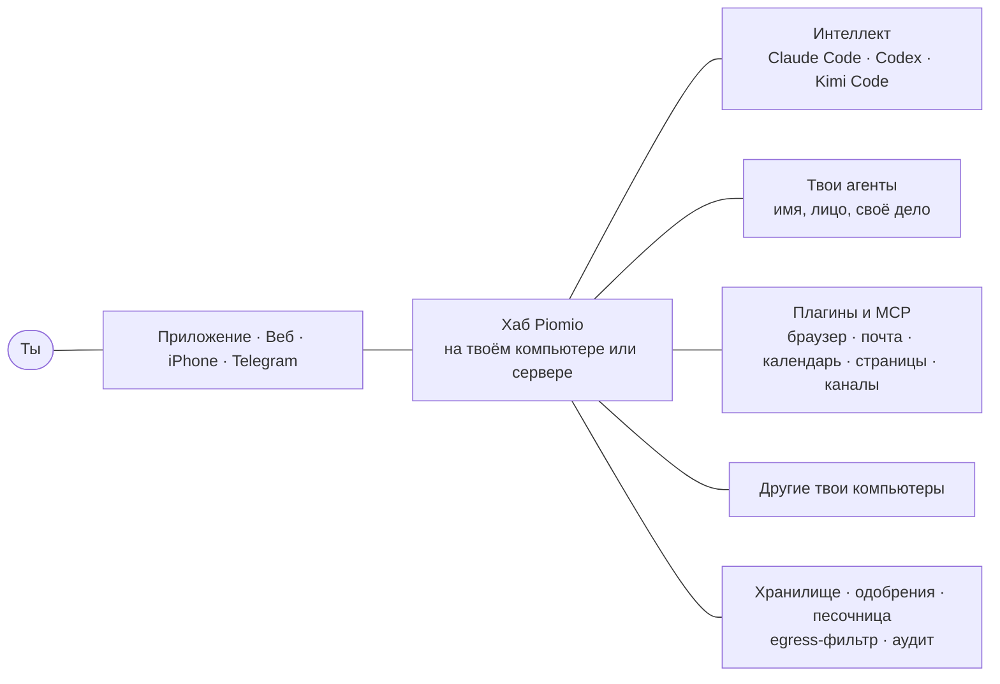

<p align="center">
  <a href="https://piomio.io/ru/"></a>
</p>

<h1 align="center">Piomio</h1>

<p align="center">
  <b>Своя команда ИИ-агентов на твоём компьютере.</b><br>
  Разбирает почту, пишет письма и отправляет их после одного твоего нажатия, работает в своём браузере и запоминает дело, если один раз его показать.<br>
  Думает на подписках, которые у тебя уже есть, через официальные Claude Code, Codex и Kimi Code. Бесплатно и с открытым кодом.
</p>

<p align="center">
  <a href="https://piomio.io/ru/"><b>▶&nbsp;Живое демо</b></a> &nbsp;·&nbsp;
  <a href="#установка">Установка</a> &nbsp;·&nbsp;
  <a href="#день-с-командой">Что умеет</a> &nbsp;·&nbsp;
  <a href="#как-это-устроено">Как устроено</a> &nbsp;·&nbsp;
  <a href="https://piomio.io/ru/docs/">Документация</a> &nbsp;·&nbsp;
  <a href="README.md">English</a>
</p>

<p align="center">
  <a href="https://github.com/legostin/piomio/releases/latest"></a>
  
  
  <a href="LICENSE"></a>
</p>

<p align="center">
  <a href="https://piomio.io/ru/"></a>
</p>
<p align="center"><sub>Живое демо на <a href="https://piomio.io/ru/">piomio.io</a>: там прямо в браузере работает настоящее приложение, глава за главой.</sub></p>

## Знакомься: команда

Piomio ставится на твой Mac, ПК или сервер, и у тебя появляется небольшая команда агентов. У каждого есть имя, лицо, своё дело и память, и говоришь ты с ними как с коллегами. Быстрое они делают сразу, а работу подольше передают друг другу задачами и возвращаются с результатом. Думают через официальные Claude Code, Codex и Kimi Code на подписках, которые у тебя уже есть. Ничего не отправляют и не покупают без твоего «да». Что-то вроде Grok, Meta Muse или OpenAI Dots, только с открытым кодом и на твоём железе.

## День с командой

| | |
|---|---|
| ☀️&nbsp;**Утренняя сводка приходит сама** | Встречи, важные письма, погода и то, что нельзя забыть. А потом агент предлагает напомнить выйти на обед в 12:30. |
| 📬&nbsp;**Ада разбирает 47 писем при тебе** | «Разбери почту». Важных три, на одно уже готов черновик ответа. Счёт попал в задачи, рассылки ушли в архив. |
| ✉️&nbsp;**Без твоего «да» ничего не уходит** | Письма, брони, пуш в GitHub и оплаты ждут одного нажатия на карточке. «Разрешать всегда» заводит правило только для этого адреса. |
| 🛡️&nbsp;**Письмо, которое попросило лишнего** | Фишинговое письмо велит агенту переслать твои счета на чужой адрес. После такого письма отправка на новый адрес всегда упирается в твоё «да». Ключи лежат в хранилище, модель видит только ссылки на них. |
| 🔌&nbsp;**Сервис подключается одной фразой** | «Подключи Notion». В чат приходит карточка, войти нужно один раз. Notion и Linear подключаются напрямую, а Gmail, Google Календарь, Slack, GitHub и многое другое через внешний сервис Composio. |
| 👥&nbsp;**Три просьбы в одном сообщении** | Ассистент раскладывает их по делам: ноутбуки отдаёт коллеге, поезда ищет сам и сразу ставит напоминание. Каждый результат приходит ответом на свою просьбу. |
| 💻&nbsp;**Лимит кончился, работа идёт дальше** | Агент чинит упавший тест на твоём MacBook через Claude Code, а когда тариф Claude упирается в лимит, продолжает на Codex. |
| 🎓&nbsp;**Покажи один раз, дальше агент сам** | Закажи воду в браузере агентов и расскажи по ходу, что важно. Агент сохранит это как навык, спросит, что можно нажимать без тебя и до какой суммы, и будет заказывать сам каждую пятницу. |
| 🗺️&nbsp;**Страница вместо простыни текста** | «Сделай страницу для прогулки в субботу». В чат приходит живая страница: маршрут, места с ценами, погода, фото. |
| 📰&nbsp;**Свой канал новостей** | «Каждое утро собирай новости про ИИ и электромобили». Агент становится редактором канала: в каждом посте суть, цифры и большая картинка. |

<p align="center">
  
</p>
<p align="center"><sub><b>Режим обучения.</b> Сделай дело один раз в браузере агентов: кликай, рассказывай голосом, выделяй важное. Получится навык, и выполнить его сможет любой агент команды.</sub></p>

<p align="center">
  
  &nbsp;&nbsp;
  
</p>
<p align="center"><sub><b>Команда в кармане.</b> Приложение для iPhone скоро появится в TestFlight. В нём все чаты и карточки, а одобрять можно по Face ID.</sub></p>

## Установка

**На Mac или Windows.** Минуты две, и больше ничего ставить не придётся.

1. Скачай Piomio из [последнего релиза](https://github.com/legostin/piomio/releases/latest): `piomio-<version>.dmg` для macOS 13.5 и новее (Apple silicon и Intel), `piomio-setup-<version>-x64.exe` для Windows 10 и 11.
2. Открой его, выбери **Новый Piomio на этом компьютере** и придумай пароль.
3. В чате нажми **Войти** у Claude Code, Codex или Kimi Code (это твоя подписка).

Готово. Дальше настройку в чате ведёт ассистент, по шагу за раз: Telegram, запасной интеллект, другие компьютеры, знакомство с тобой.

**На сервере.** Одна команда на Linux (x64 или arm64), под root:

```bash
curl -fsSL https://piomio.io/install.sh | sh
```

Установщик заводит для хаба и его агентов пользователя `piomio` и печатает код установки, потом страницу входа в Tailscale, а когда войдёшь (хватит бесплатного аккаунта), — постоянную ссылку на хаб, которая открывается на любом телефоне и компьютере (подойдёт и туннель `ssh -L`). Войди от этого пользователя в Claude Code, Codex или Kimi Code, и агенты будут пользоваться им как есть: копировать ничего не нужно. А ещё сервер может стать компьютером хаба на твоём Mac: его команду покажет карточка подключения компьютера. Шаг за шагом: [инструкция на сайте](https://piomio.io/ru/server/), а в документации — [На сервере с Linux](https://piomio.io/ru/docs/server/).

**Через твой ИИ.** Уже пользуешься Claude Code, Codex или Kimi Code? Вставь это в него на компьютере или сервере, где будет работать Piomio:

```text
Установи Piomio на этот компьютер и настрой его для меня. Действуй по инструкции https://piomio.io/setup.md шаг за шагом. Тебе понадобится интернет: если загрузка не проходит, попроси у меня разрешение, а не останавливайся. Спрашивай, когда решение за мной, и никогда не проси пароли или ключи. В конце скажи, как открыть чат.
```

Он сам поймёт, что это за машина, поставит Piomio и спросит только то, что решать тебе ([что он будет делать](https://piomio.io/setup.md)). На Mac или ПК Piomio потом работает с тем же Claude Code, Codex или Kimi Code, и входить второй раз не нужно. Codex говорит, что не может спросить перед загрузкой? Выбери в его `/permissions` «Ask for approval».

**На iPhone.** Приложение скоро появится в TestFlight. К хабу оно подключается по QR-коду, а одобрять можно по Face ID.

**На других компьютерах.** Каждый подключается к команде по одноразовому коду. Агентам становятся доступны его файлы, его Claude Code или Codex (с твоим же входом на этом компьютере) и, если разрешишь, команды. Подробнее в разделе [Машины и другие компьютеры](https://piomio.io/ru/docs/machines/).

## Как с ним работать

- **Просто пиши.** Как человеку: хоть несколько дел сразу, хоть пока агент ещё занят. На быстрое он отвечает сразу, а то, где есть шаги, уходит задачей в сторону, и результат приходит ответом на твоё сообщение.
- **Отвечай кнопками.** Агенты задают вопросы кнопками под сообщениями. Карточки в чате подключают сервисы, принимают ключи и показывают, что агент собирается сделать.
- **Одно «да».** Всё, что уходит с компьютера наружу (письмо, бронь, пуш, оплата), ждёт одного нажатия. «Разрешать всегда» заводит узкое правило: один адресат или сайт, сумма до предела.
- **Пусть работает само.** Напоминания, расписания, слежка за страницами и каналы новостей крутятся в фоне и сами решают, промолчать, добавить в сводку, написать тебе или спросить.
- **Научи.** Покажи дело в браузере один раз, и агент сохранит его как навык, а потом сделает по просьбе или по расписанию.
- **Работай рядом.** Пио — маленькое лицо поверх всех приложений на Mac или ПК: видит, в каком окне ты работаешь, говорит и слушает локальным открытым голосом, подсказывает, когда есть что сказать, и берёт мышь и клавиатуру, когда ты их передашь.
- **Там, где тебе удобно.** Приложение для macOS и Windows, любой браузер, Telegram и скоро приложение для iPhone, и везде одни и те же чаты. По одной личной ссылке хаб открывается откуда угодно, порты открывать не нужно.

## Как это устроено



- **Хаб** — один процесс Node.js, в приложении для компьютера он уже внутри. В нём чаты, агенты, память, задачи, плагины, хранилище и пульт безопасности.
- **Интеллект** — то, чем думают агенты: официальные CLI Claude Code, Codex и Kimi Code, в которые ты входишь со своей подпиской, а на хабе, где это разрешено, ещё и обычные API-ключи. Упрётся один в лимит, и агент продолжит на следующем.
- **Агенты** — обычные markdown-файлы: имя, лицо, промпт, какие интеллекты и инструменты им можно брать. Новых заводят прямо в чате.
- **Всё остальное — плагины,** даже интерфейс: браузер, память, триггеры, Telegram, интеграции. Подробнее в [docs/plugins.ru.md](docs/plugins.ru.md).

## Безопасность коротко

- **Секреты лежат в хранилище.** Модель видит только ссылки `vault://`, а сами значения вырезаются из всего, что уходит в модель, канал или лог.
- **Наружу только после твоего «да».** Одобрения, хранилище и журнал аудита живут в отдельном пульте. Если агент читал чужое письмо или страницу, на новый адрес он снова спросит.
- **Песочница.** Интеллекты и плагины ходят в сеть через egress-фильтр с белыми списками. На Mac собственные команды CLI-интеллектов остаются в папке агента (песочница macOS), а за остальным спрашивают тебя; на сервере всё работает от пользователя без sudo.
- **Аудит.** Каждый вызов инструмента, решение и обращение к хранилищу пишутся в журнал с цепочкой хэшей, и его целостность можно проверить.

## Документация

Всё подробно, для твоей версии, — на сайте: **[piomio.io/ru/docs](https://piomio.io/ru/docs/)**. Страницы лежат в Markdown в [docs/guide](docs/guide), рядом с кодом, который описывают, и меняются вместе с ним.

<a id="справка"></a><a id="на-сервере"></a><a id="сервер-хаб"></a><a id="сервер-компьютер"></a><a id="сервер-адрес"></a><a id="языки"></a><a id="другие-компьютеры"></a><a id="телефон"></a><a id="доступ-из-любого-места"></a><a id="свой-прокси"></a><a id="переменные-окружения"></a>

| | |
|---|---|
| **Начало** | [Обзор](https://piomio.io/ru/docs/) · [Установка на Mac или ПК](https://piomio.io/ru/docs/install/) · [На сервере с Linux](https://piomio.io/ru/docs/server/) · [Первый запуск](https://piomio.io/ru/docs/first-run/) |
| **Работа с командой** | [Чат](https://piomio.io/ru/docs/chat/) · [Агенты и команда](https://piomio.io/ru/docs/agents/) · [Задачи, расписания, «Входящие»](https://piomio.io/ru/docs/tasks/) · [Каналы](https://piomio.io/ru/docs/channels/) · [Страницы](https://piomio.io/ru/docs/pages/) · [Браузер и обучение](https://piomio.io/ru/docs/browser/) |
| **Интеллект и компьютеры** | [Интеллект и вход](https://piomio.io/ru/docs/brains/) · [Машины и другие компьютеры](https://piomio.io/ru/docs/machines/) · [Приложение для iPhone](https://piomio.io/ru/docs/phone/) · [Telegram](https://piomio.io/ru/docs/telegram/) · [Доступ из любого места](https://piomio.io/ru/docs/anywhere/) · [Обновления](https://piomio.io/ru/docs/updates/) |
| **Безопасность** | [Подтверждения и автомод](https://piomio.io/ru/docs/approvals/) · [Модель безопасности](https://piomio.io/ru/docs/security/) |
| **Справочник** | [Плагины и интеграции](https://piomio.io/ru/docs/plugins/) · [Настройки](https://piomio.io/ru/docs/settings/) · [Если что-то не так](https://piomio.io/ru/docs/troubleshooting/) |

<a id="приложение-для-компьютера"></a>
<details>
<summary><b>Разработка и сборка приложения</b></summary>

```bash
npm install
npm run build        # web UI, console, UI plugins, node daemon bundle
npm run build:tailnet  # the hub's Tailscale node (Go; --all for every platform)
npm run dev          # hub on :8080 / :8081, egress proxy on :8089 (data in .data/)
npm test             # unit and integration tests
npm run typecheck
```

Нужен Node.js 24.5+ (TypeScript запускается без сборки). Без Google Chrome плагин браузера сам скачивает Chromium для Playwright, если при старте его нет (один раз, в кэш Playwright или в `PLAYWRIGHT_BROWSERS_PATH`); браузерные вызовы на это время ждут загрузки. Чтобы отключить это и поставить браузер вручную (`npx playwright install chromium`), задай `PLAYWRIGHT_SKIP_BROWSER_DOWNLOAD=1`. Устройство проекта и соглашения описаны в [CLAUDE.md](CLAUDE.md), дизайн — в [docs/superpowers/specs](docs/superpowers/specs/2026-10-26-piomio-design.md). Сообщения ядра лежат в `packages/core/src/locales/{en,ru}.ts`, сообщения плагинов — в `.piomio-plugin/locales/{en,ru}.json`; `npm test` проверяет, что каждый перевод совпадает с английским.

#### Приложение для компьютера

```bash
npm run package:desktop   # в Windows: dist/desktop/piomio-setup-<version>-x64.exe
                          # в macOS:   dist/desktop/piomio-<version>.dmg и .pkg
```

Приложение лежит в `packages/desktop` (Tauri 2: Rust в `src-tauri`, его экраны настройки в `ui`). Сборка собирает интерфейсы, складывает хаб с production-зависимостями и официальной сборкой Node 24, сверенной с SHA-256 из релиза (`packaging/desktop/stage.mjs`; другой релиз задаёт `NODE_VERSION`), и упаковывает его в приложение. Нужен Rust из [rustup](https://rustup.rs); в macOS ещё цель Intel для универсальной сборки (`rustup target add x86_64-apple-darwin`) и инструменты командной строки Xcode. Тексты приложения и установщиков лежат в `packaging/desktop/locales/{en,ru}.json`.

Тихая установка: `piomio-setup-<version>-x64.exe /S` (с `/NOSTART` приложение не запустится) в Windows; `sudo installer -pkg piomio-<version>.pkg -target /` в macOS (по SSH или через MDM), а `sudo /Applications/Piomio.app/Contents/Resources/uninstall.sh <uid> <home> [--delete-data]` удаляет его. `Piomio --mode hub --background` делает выбор первого запуска без окна, `Piomio --quit` останавливает работающее приложение. `.github/workflows/desktop.yml` собирает обе версии на чистых машинах и проверяет, что они ставятся, запускают хаб, выходят и удаляются.

Чтобы попробовать сборку рядом с установленным Piomio, добавь `-- --test`: получится **Piomio Test** (`piomio-test-<version>.dmg`, `piomio-test-setup-<version>-x64.exe`) со своими данными, подключением машины, автозапуском и портами сразу за основными (41790, пульт — 41791, egress-прокси — 41799). В заголовке окна, меню в трее и на экранах настройки видно, что это тестовая сборка.

Чтобы запустить приложение из исходников, не трогая установленный Piomio: один раз подготовь сборку (`node packaging/desktop/stage.mjs --skip-build`), затем `PIOMIO_APP_ROOT=$PWD/dist/desktop/stage-darwin/app PIOMIO_DATA_DIR=/tmp/owl-data npm run tauri -w @piomio/desktop -- dev`, а в `/tmp/owl-data/desktop.json` положи `{"port":18080}`. С заданным `PIOMIO_DATA_DIR` приложение не прописывает себя в автозапуск.

</details>

## Лицензия

[Apache-2.0](LICENSE)

Piomio — независимый проект с открытым кодом, он не связан с Anthropic, OpenAI и Moonshot AI и не одобрен ими. Claude и Claude Code — товарные знаки Anthropic, ChatGPT и Codex — товарные знаки OpenAI, Kimi — товарный знак Moonshot AI. Piomio запускает их официальные CLI, в которые ты входишь со своим аккаунтом, и их использование подчиняется условиям этих компаний.
