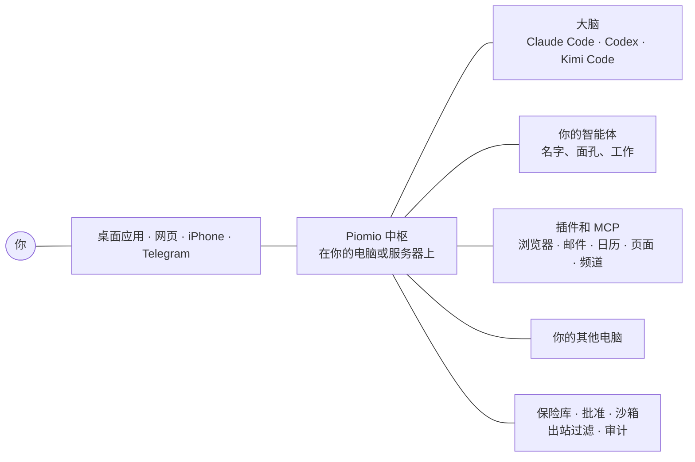

<p align="center">
  <a href="https://piomio.io/zh/"></a>
</p>

<h1 align="center">Piomio</h1>

<p align="center">
  <b>一支住在你自己电脑上的小型 AI 智能体团队。</b><br>
  他们整理邮件，起草回复，你点一下就能发出；一件事演示一遍，他们就会接着做。<br>
  免费、开源，用你已经在付费的订阅，通过官方的 Claude Code、Codex 和 Kimi Code CLI。
</p>

<p align="center">
  <a href="https://piomio.io/zh/"><b>▶&nbsp;实时演示</b></a> &nbsp;·&nbsp;
  <a href="#安装">安装</a> &nbsp;·&nbsp;
  <a href="#和团队过一天">它能做什么</a> &nbsp;·&nbsp;
  <a href="#它怎么工作">它怎么工作</a> &nbsp;·&nbsp;
  <a href="https://piomio.io/zh/docs/">文档</a> &nbsp;·&nbsp;
  <a href="README.md">English</a> &nbsp;·&nbsp;
  <a href="README.ru.md">Русский</a>
</p>

<p align="center">
  <a href="https://github.com/legostin/piomio/releases/latest"></a>
  
  
  <a href="LICENSE"></a>
</p>

<p align="center">
  <a href="https://piomio.io/zh/"></a>
</p>
<p align="center"><sub>这是真实的应用。<a href="https://piomio.io/zh/">piomio.io</a> 在浏览器里的演示中枢上运行它，一次一章。应用界面目前仍是英文。</sub></p>

## 认识团队

Piomio 是你自己运行的个人智能体平台。你有一支不大的智能体团队，每个都有名字、面孔、工作和记忆，你像跟同事说话那样跟他们说话。快的事他们当场答。长一点的工作作为任务传下去，做完再回来找你。

他们通过官方的 Claude Code、Codex 和 Kimi Code CLI 思考，用你已经有的订阅登录，跑在你的 Mac、PC 或服务器上。发送或购买任何东西之前，他们会问你。可以把它看成 Grok、Meta Muse 和 OpenAI Dots 的开源替代，只不过它住在你自己的机器上。

## 和团队过一天

| | |
|---|---|
| ☀️&nbsp;**早晨简报自己来** | 今天的会议、值得读的邮件、天气，还有你总忘的牙医。然后它提议 12:30 提醒你出门吃午饭。 |
| 📬&nbsp;**47 封邮件，看着它整理完** | 「去整理我的邮件。」结果重要的有三封。一封回复起草好了，发票变成任务，订阅邮件进了归档。（Gmail 通过 Composio 连接。） |
| ✉️&nbsp;**发出去之前它会问** | 邮件、预订、代码推送和付款都等你在卡片上点一下。「Always allow」只为那一个地址加一条规则，别的不行。 |
| 🛡️&nbsp;**那封要求过分的邮件** | 一封钓鱼邮件让智能体转发你的发票。因为智能体刚刚读过外部邮件，新的收件人必须得到你的同意。密钥放进模型永远看不到的保险库。 |
| 🔌&nbsp;**一句话连上一个服务** | 「连接我的 Notion。」聊天里出现一张卡片，你登录一次。Notion、Linear，以及任何带 MCP 服务器的东西直接连接；Gmail、Google Calendar、Slack、GitHub 和更多服务通过 Composio 接入，那是一个外部服务，它的云会看到这些数据。 |
| 👥&nbsp;**三件事，一条消息** | 助理把它们拆开。一个队友比较笔记本，同时设好提醒、找到车次，每个答案都作为你那条消息的回复回来。 |
| 💻&nbsp;**Claude Code 用完了，接着用 Codex** | 一个智能体在你的 MacBook 上通过 Claude Code 修一个失败的测试。Claude 订阅碰到限额，它改用 Codex 继续。 |
| 🎓&nbsp;**一件事演示一遍** | 在智能体的浏览器里订水，边做边说。智能体把它存成一项技能，问哪些可以不经你确认去点、金额到多少，然后每周五下单。 |
| 🗺️&nbsp;**一页，而不是一堵文字** | 「给周六的散步做一页。」你在聊天里得到一个可交互的页面：路线、带价格的地点、天气和照片。 |
| 📰&nbsp;**你自己的新闻频道** | 「每天早上，收集 AI 和电动汽车的新闻。」一个智能体当编辑，发出要点、数字和一张图。 |

<p align="center">
  
</p>
<p align="center"><sub><b>教学模式。</b> 在智能体的浏览器里做一遍。点击、说话、标出要紧的地方，它就变成一项团队里谁都能跑的技能。</sub></p>

<p align="center">
  
  &nbsp;&nbsp;
  
</p>
<p align="center"><sub><b>iPhone 应用</b>在 <a href="https://testflight.apple.com/join/g4hCfeXA">TestFlight</a> 上处于 beta，里面有每个聊天和卡片，批准用 Face ID。界面目前仍是英文。</sub></p>

## 安装

**在 Mac 或 Windows 上。** 大约两分钟，不用再装别的。

1. 从[最新版本](https://github.com/legostin/piomio/releases/latest)下载 Piomio：macOS 13.5 或更高版本用 `piomio-<version>.dmg`（Apple 芯片和 Intel），Windows 10 和 11 用 `piomio-setup-<version>-x64.exe`。
2. 打开它，选择 **A new Piomio on this computer**，然后设一个密码。
3. 在聊天里，对 Claude Code、Codex 或 Kimi Code（你的订阅）点 **Sign in**。

之后助理在聊天里一件一件带你走完剩下的：Telegram、备用大脑、其他电脑，以及认识你。应用里的按钮目前是英文。

**在服务器上。** Linux（x64 或 arm64）上以 root 执行一条命令：

```bash
curl -fsSL https://piomio.io/install.sh | sh
```

它为中枢和智能体创建用户 `piomio`，打出设置码，然后是 Tailscale 的登录页；你用一个免费账户登录之后，是中枢的永久链接，在任意手机或电脑上都能打开（`ssh -L` 隧道也可以）。以这个用户登录 Claude Code、Codex 或 Kimi Code，智能体就照原样使用它：不用复制任何东西。服务器也可以成为你 Mac 上那个中枢的一台电脑：连接电脑的卡片会给出它的命令。分步说明：[服务器指南](https://piomio.io/zh/server/)，文档里的 [On a Linux server](https://piomio.io/zh/docs/server/)（文档正文目前仍是英文）。

**用你的 AI。** 已经在用 Claude Code、Codex 或 Kimi Code？把它贴进那台要跑 Piomio 的电脑或服务器上的对话里：

```text
在这台电脑上安装 Piomio 并为我完成设置。请按 https://piomio.io/setup.md 逐步操作。你需要联网：如果下载失败，向我申请权限，不要直接停下来。遇到该由我决定的事就问我，不要向我索要密码或密钥。最后告诉我如何打开聊天。
```

它会判断这是什么机器，装上 Piomio，只问该由你决定的事（[它会做什么](https://piomio.io/setup.md)）。在 Mac 或 PC 上，Piomio 随后就用同一份 Claude Code、Codex 或 Kimi Code，不用再登录一次。Codex 说下载前没法问你？在它的 `/permissions` 里选 “Ask for approval”。

**在 iPhone 上。** 应用在 [TestFlight](https://testflight.apple.com/join/g4hCfeXA) 上处于 beta（iOS 26 或更高版本）。它通过二维码和你的中枢配对，批准需要 Face ID。

**在更多电脑上。** 每一台用一次性代码加入。智能体然后可以使用它的文件、它自己的 Claude Code 或 Codex（在那边用你自己的账户登录），以及你允许的命令。见 [Machines and other computers](https://piomio.io/zh/docs/machines/)（英文）。

## 怎么用

- **直接说。** 像给人写信那样给智能体写。一次说几件事也行，哪怕它正忙。快的事马上答。有步骤的事变成旁边的任务，答案作为你所问内容的回复回来。
- **点，而不是打。** 智能体常常在消息下面用按钮提问。聊天里的卡片连接服务、接收密钥，并显示智能体准备做什么。
- **同意一次。** 智能体发出去的任何东西（邮件、预订、推送、付款）都等你点一下。「Always allow」为一名收件人或一个网站立一条窄规则，并设一个金额上限。
- **让它自己跑。** 提醒、日程、页面监视和新闻频道在后台工作。每一个自己决定是保持安静、加进摘要、通知你，还是问你。
- **教它。** 把浏览器里的一件事演示一遍。它把这存成一项技能，在你要求时做，或按时间表做。
- **你在哪里都行。** macOS 和 Windows 的桌面应用、任意浏览器、Telegram 和 iPhone 应用里是同一批聊天。一条私人链接从任何地方到达你的中枢，不用开放端口。

## 它怎么工作



- **中枢**是一个 Node.js 进程（桌面应用自带 Node）。它持有聊天、智能体、记忆、任务、插件、保险库和安全控制台。
- **大脑**是智能体用来思考的东西：官方的 Claude Code、Codex 和 Kimi Code CLI，用你自己的订阅登录；允许的中枢上也可以用普通 API 密钥。一个碰到限额，智能体就用下一个继续。
- **智能体**是 Markdown 文件，带名字、面孔、提示词，以及它们可以使用的大脑和工具。你在聊天里创建新的。
- **其他一切都是插件，**包括界面：浏览器、记忆、Telegram、集成。见 [docs/plugins.md](docs/plugins.md)。

## 安全简况

- **密钥留在保险库里。** 模型永远只看得到 `vault://` 引用，密钥的值会从任何要发给模型、频道或日志的内容里剥掉。
- **触达外部的动作需要你点头。** 单独的控制台放着批准、保险库和审计日志。智能体读过外部内容（邮件、网页）之后，新的收件人需要你再同意一次。
- **沙箱。** 大脑和插件通过带允许列表的出站过滤访问网络。在 Mac 上，CLI 大脑自己的命令留在智能体的文件夹里（macOS 沙箱），其余的会问你；在服务器上，一切都以一个没有 sudo 的用户运行。
- **审计。** 每一次工具调用、决定和保险库访问都写入一条你可以核验的哈希链日志。

## 文档

详细内容、对应你所运行的版本，在网站上：**[piomio.io/zh/docs](https://piomio.io/zh/docs/)**。这些页面目前仍是英文。它们是 [docs/guide](docs/guide) 里的 Markdown，放在它们所描述的代码旁边，并随代码一起改。

<a id="reference"></a><a id="on-a-server"></a><a id="server-hub"></a><a id="server-computer"></a><a id="server-address"></a><a id="languages"></a><a id="other-computers"></a><a id="phone"></a><a id="access-from-anywhere"></a><a id="your-own-proxy"></a><a id="environment-variables"></a>

| | |
|---|---|
| **入门** | [概览](https://piomio.io/zh/docs/) · [在 Mac 或 PC 上安装](https://piomio.io/zh/docs/install/) · [在 Linux 服务器上](https://piomio.io/zh/docs/server/) · [第一次运行](https://piomio.io/zh/docs/first-run/) |
| **和团队一起工作** | [聊天](https://piomio.io/zh/docs/chat/) · [智能体和团队](https://piomio.io/zh/docs/agents/) · [任务、日程、收件箱](https://piomio.io/zh/docs/tasks/) · [频道](https://piomio.io/zh/docs/channels/) · [页面](https://piomio.io/zh/docs/pages/) · [浏览器和教学模式](https://piomio.io/zh/docs/browser/) |
| **大脑和电脑** | [大脑和登录](https://piomio.io/zh/docs/brains/) · [机器和其他电脑](https://piomio.io/zh/docs/machines/) · [iPhone 应用](https://piomio.io/zh/docs/phone/) · [Telegram](https://piomio.io/zh/docs/telegram/) · [从任意位置访问](https://piomio.io/zh/docs/anywhere/) · [更新](https://piomio.io/zh/docs/updates/) |
| **安全** | [批准和自动模式](https://piomio.io/zh/docs/approvals/) · [安全模型](https://piomio.io/zh/docs/security/) |
| **参考** | [插件和集成](https://piomio.io/zh/docs/plugins/) · [设置](https://piomio.io/zh/docs/settings/) · [故障排除](https://piomio.io/zh/docs/troubleshooting/) |

<a id="desktop-app"></a>
<details>
<summary><b>开发和构建桌面应用</b></summary>

```bash
npm install
npm run build        # web UI, console, UI plugins, node daemon bundle
npm run build:tailnet  # the hub's Tailscale node (Go; --all for every platform)
npm run dev          # hub on :8080 / :8081, egress proxy on :8089 (data in .data/)
npm test             # unit and integration tests
npm run typecheck
```

需要 Node.js 24.5+（TypeScript 不用构建步骤就能跑）。没有 Google Chrome 时，浏览器插件第一次启动会自己下载 Playwright 的 Chromium（一次性，进 Playwright 的缓存或 `PLAYWRIGHT_BROWSERS_PATH`）；这段时间里的浏览器调用会等它。设 `PLAYWRIGHT_SKIP_BROWSER_DOWNLOAD=1` 可以关掉这个，再自己用 `npx playwright install chromium` 安装。项目布局和约定写在 [CLAUDE.md](CLAUDE.md)，设计写在 [docs/superpowers/specs](docs/superpowers/specs/2026-10-26-piomio-design.md)（俄文）。核心文案在 `packages/core/src/locales/{en,ru}.ts`，插件文案在 `.piomio-plugin/locales/{en,ru}.json`；`npm test` 检查每份翻译是否和英文一致。

#### 桌面应用

```bash
npm run package:desktop   # 在 Windows 上：dist/desktop/piomio-setup-<version>-x64.exe
                          # 在 macOS 上：dist/desktop/piomio-<version>.dmg 和 .pkg
```

应用在 `packages/desktop`（Tauri 2：Rust 在 `src-tauri`，设置屏幕在 `ui`）。构建会编译界面，把中枢连同它的生产 `node_modules` 和官方 Node 24 构建放在一起（对照该版本的 SHA-256，`packaging/desktop/stage.mjs`；`NODE_VERSION` 可以换一个版本），再打进应用。需要 [rustup](https://rustup.rs) 的 Rust；在 macOS 上还要通用构建的 Intel 目标（`rustup target add x86_64-apple-darwin`）和 Xcode 命令行工具。应用和安装包文案在 `packaging/desktop/locales/{en,ru}.json`。

静默安装：Windows 上 `piomio-setup-<version>-x64.exe /S`（加 `/NOSTART` 则装完不启动）；macOS 上 `sudo installer -pkg piomio-<version>.pkg -target /`（通过 SSH 或 MDM），`sudo /Applications/Piomio.app/Contents/Resources/uninstall.sh <uid> <home> [--delete-data]` 再把它卸掉。`Piomio --mode hub --background` 在没有窗口的情况下做第一次运行的选择，`Piomio --quit` 停掉正在运行的应用。`.github/workflows/desktop.yml` 在干净的运行器上构建两者，并检查它们能安装、启动中枢、退出和卸载。

想在已安装的 Piomio 旁边试一个构建，加上 `-- --test`：会得到 **Piomio Test**（`piomio-test-<version>.dmg`、`piomio-test-setup-<version>-x64.exe`），有自己的数据、机器配对、登录时启动项，以及紧挨应用端口的端口（41790，控制台 41791，出站代理 41799）。窗口标题、托盘菜单和设置屏幕会标明这是测试构建。

想从源码跑应用、又不碰到已安装的 Piomio：先准备一次（`node packaging/desktop/stage.mjs --skip-build`），然后 `PIOMIO_APP_ROOT=$PWD/dist/desktop/stage-darwin/app PIOMIO_DATA_DIR=/tmp/owl-data npm run tauri -w @piomio/desktop -- dev`，并在 `/tmp/owl-data/desktop.json` 里放 `{"port":18080}`。设了 `PIOMIO_DATA_DIR` 时，应用不会写登录时启动项。

</details>

## 许可证

[Apache-2.0](LICENSE)

Piomio 是一个独立的开源项目，与 Anthropic、OpenAI 或 Moonshot AI 无关，也未获其认可。Claude 和 Claude Code 是 Anthropic 的商标；ChatGPT 和 Codex 是 OpenAI 的商标；Kimi 是 Moonshot AI 的商标。Piomio 运行它们的官方 CLI，你用自己的账户登录，每次使用仍受该提供商条款约束。
